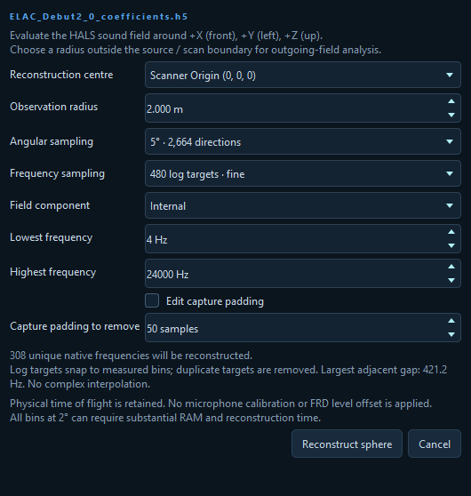
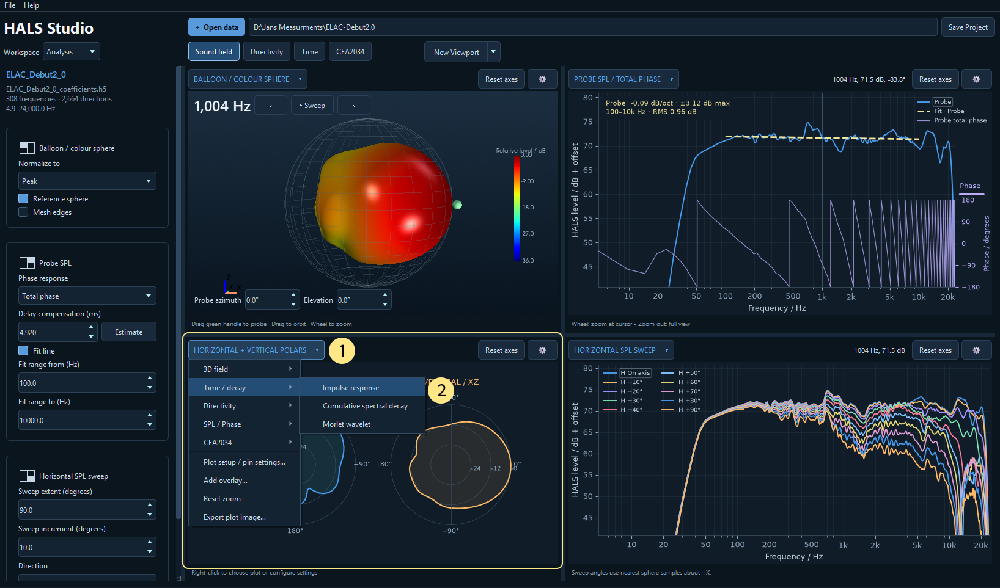
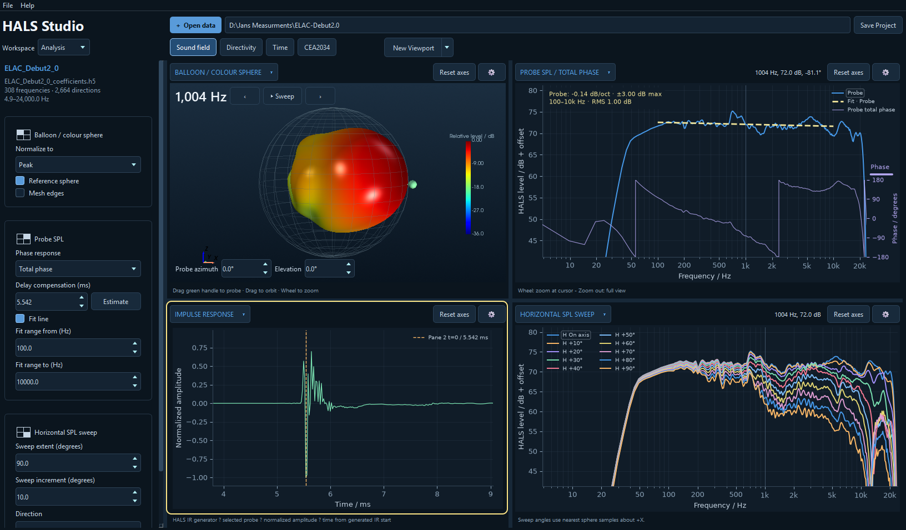
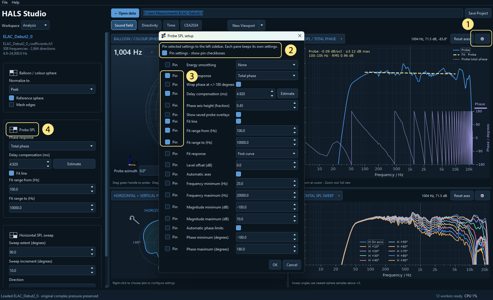

# Analysis workspace overview

## Viewport guides

Start here for importing data, creating and saving viewports, pinning settings and using plot controls. Then open a guide for the viewport you want to explore. All examples use the ELAC Debut 2.0 dataset described below.

| Guide | What you will find |
| --- | --- |
| [Sound field](analysis_01_sound_field.md) | Linked balloon and Probe SPL examples, phase and delay compensation, polars, SPL sweeps and overlays. |
| [Directivity](analysis_02_directivity.md) | Horizontal and vertical sonograms, intersecting sonograms and directivity waterfalls. |
| [Time](analysis_03_time.md) | Impulse response, wavelet and CSD, milliseconds and cycles, and negative-time allowance. |
| [CEA2034](analysis_04_cea2034.md) | Spinorama, reflection breakouts, predicted in-room response and H/V globes. |

## What Analysis is for

The Analysis workspace lets you explore the full three-dimensional sound field created by HALS. Conventional acoustic software usually shows individual microphone responses, polar cuts or directivity maps. HALS also gives you a continuous spatial model: you can inspect radiation in every direction, move a virtual probe around the loudspeaker, and connect what you see in 3D with its frequency, phase and time response.

Use Analysis to investigate questions such as: Where does a radiation lobe point? Does a crossover produce vertical cancellation? How does the response change off axis? Which frequencies continue to ring? The plots offer different views of the same reconstructed field.

This guide uses the **ELAC Debut 2.0** dataset. The examples reconstruct the **Internal** field on a **2 m** observation sphere with **5° angular sampling** and **480 logarithmic frequency targets**. Targets snap to available coefficient frequencies, so the actual number of frequencies can be smaller. The screenshots illustrate this dataset, rather than prescribing settings for every loudspeaker.

**Reading levels:** the response axis is labelled **HALS level / dB + offset**. These values are not automatically calibrated absolute SPL. Relative directivity plots describe differences in level. Check **Calibration** before comparing absolute levels with another system.

## Open data and choose the import settings

Choose **Analysis** in the Workspace selector, then **Open data** (or **Ctrl+O**). Open a HALS project or its Stage 4 coefficient file (`.h5` / `.hdf5`). A project provides useful context, including its reference axis. A saved full-sphere cache can also be opened; a cache contains the sphere already evaluated, so coefficient reconstruction settings require the original coefficient file.

For the example dataset, open `ELAC_Debut2_0_project.json` in the ELAC-Debut2.0 folder, or `outputs/coefficients/ELAC_Debut2_0_coefficients.h5`.

The first coefficient import opens the reconstruction dialog. To revisit it, use **File → Analysis Import Settings**. Accepting these settings reconstructs the sphere again while retaining the current project and views. Wait for reconstruction to finish, or cancel the current reconstruction before changing them.

| Setting | What it changes |
| --- | --- |
| **Reconstruction centre** | The centre of the observation sphere used by all Analysis plots. Available choices depend on the project geometry. This changes where the field is evaluated. |
| **Observation radius** | The distance from that centre to the virtual observation positions. For outgoing-field inspection, choose a sphere outside the source / scan boundary. The balloon's displayed deformation is a level visualization, not this physical distance. |
| **Angular sampling** | The density of directions evaluated around the sphere. Start with 5°; 10° is faster for previews, while 3° and 2° reveal finer spatial detail at higher memory and calculation cost. |
| **Frequency sampling** | Logarithmic targets select actual native coefficient bins; duplicate selections are removed. They do not create interpolated complex responses. Use **All native bins · phase / delay** when inspecting rapid phase changes or estimating delay accurately. |
| **Field component** | **Internal** isolates the source field; **External** inspects the external / room contribution; **Total** combines the two. Internal is the usual starting point for loudspeaker directivity. |
| **Lowest / Highest frequency** | Limits the reconstructed band. The sampling note reports the number of unique native frequencies and their largest adjacent gap. |
| **Edit capture padding / Capture padding to remove** | Overrides the default removal of 50 capture-padding samples. This corrects capture padding, not physical propagation time. Change it only when the capture requires a different value. |

Physical time of flight is retained. Reconstruction itself applies neither microphone calibration nor an FRD level offset. The sidebar's **Calibration** dialog controls those separately and shares them with Export. Its **FRD offset / dB** shifts SPL levels without changing DI or phase.

**A useful first import:** Internal, 2 m, 5°, 480 log targets. If phase looks implausible, reimport with all native bins before drawing conclusions. Dense angular sampling cannot recover detail missing from the underlying solved model.

## Find your way around the views

A **viewport** is a named arrangement of four independent plot panes. The supplied buttons are **Sound field**, **Directivity**, **Time**, and **CEA2034**. Each answers a different kind of question. Select a button to switch layouts; drag the dividers between panes to give a plot more room.

### The numbered callouts identify

1.  New Viewport control beside the view buttons
2.  Pinned settings sidebar
3.  3D Balloon 
4.  Probe SPL and phase
5.  Horizontal and Vertical polars
6. Horizontal SPL sweep

### Set a pane's plot type

Each of the four panes can display a plot of your choice. You can change a pane within any viewport, or create a new viewport for your own arrangement.

1. Click the **plot title** at the top left of the pane (**1** in the image below). You can also right-click within the pane to open the same menu.
2. Open a category: **3D field**, **Time / decay**, **Directivity**, **SPL / Phase**, or **CEA2034**.
3. Choose the plot you want. In this example, **Time / decay → Impulse response** (**2**) to replace the bottom-left polar plot.

The selected pane updates to show the new plot, and its title changes to **Impulse response**. The the settings avilible from the **gear button** as well as the **pinned settings sidebar** also update.

For **SPL / Phase** and **CEA2034**, magnitude entries are checkboxes: select several to compare responses within one pane. In **SPL / Phase**, choose **No phase**, **Total phase** or **Minimum phase** separately, and select **Wrapped** or **Unwrapped** under Phase display. Click outside the menu when you have finished selecting responses.

Use the pane's **gear** to adjust the settings available for its new plot type. Click **Save Project** to keep your pane choices with the project; use **Save as default template...** if you want this arrangement available as your personal default.

### Make a viewport and save your defaults

1. Select the existing viewport closest to what you want.
2. Click **New Viewport** and enter a unique name. This copies the current arrangement.
3. Click each pane's title to choose its plot, use its gear for settings, and resize the dividers. You can use the same plot type in more than one pane with different settings.
4. Click **Save Project** (**Ctrl+S**) to keep the views, settings, pins, divider positions and 3D cameras with that project.

Changes are remembered as you switch between views during the session. Save the project to retain them when reopening it. Hold and drag a viewport button to reorder it; right-click a button to rename or delete it. At least one view remains.

To reuse your arrangement for other projects, open the arrow beside **New Viewport** and choose **Save as default template...**. This saves the whole current collection of viewports as your personal template. It changes the defaults for new projects and what **Reset views** restores.

**Reset views** replaces the current collection with your saved default template, or the supplied template if you have not saved one. It does not simply undo a zoom. Use a pane's **Reset axes** for that.

### Put frequently used settings in the left sidebar

Every pane keeps its own settings. Pinning makes selected controls available without repeatedly opening its setup dialog.

1. Click the pane's **gear button** to open its settings.
2. Enable **Pin settings - show pin checkboxes**.
3. Tick **Pin** beside the settings you use most, then choose **OK**.
4. Use the controls in the left sidebar. A small four-pane position icon identifies which pane each group controls.

For example, pin balloon normalization, Probe SPL delay compensation, or sweep extent and increment. Pinning a setting does not link it to other panes. Save the project, or save your default template, to retain the chosen pins in the appropriate place.

## Controls shared by the plots

The **pane title** opens the plot-selection menu. Right-clicking a pane also offers plot choices, **Plot setup / pin settings…**, and image-saving options. The **gear** opens settings for the current plot; the available controls depend on the plot type. Use **OK** to apply setup changes or **Cancel** to discard them.

| Action | Control |
| --- | --- |
| Pan a 2D Cartesian plot | Drag with the **middle mouse button**. |
| Zoom a 2D plot | Roll the **wheel over the plot**, centred on the pointer. |
| Zoom only the horizontal axis | Roll the wheel in the axis-label margin **below the plot**. |
| Zoom only the vertical axis | Roll the wheel beside the **left vertical axis**; use the right margin for a separate phase axis. |
| Restore the plot's configured bounds | Click **Reset axes**. With manual limits enabled, this returns to those limits. |
| Rotate a 3D plot | Drag within the scene. In the balloon, drag away from the green probe handle to orbit. |
| Zoom a 3D plot | Roll the wheel; use **Reset axes** to restore its camera framing. |
| Rotate a polar or circular globe display | Drag its curved rotation handle or outer rim. This changes display orientation, not the reference axis. |
| Resize the phase display | Drag the purple handle at the top of its right-hand axis, or edit **Phase axis height (fraction)**. |

Polar plots use radial wheel zoom rather than independent Cartesian axis zoom. A 3D plot's controls operate its camera; the axis-margin gestures apply to 2D charts.

**Automatic axes** fits response plots to their data. Entering manual frequency, magnitude, phase or DI limits disables the corresponding automatic limits. Each pane can have its own scale, smoothing and display range, so check those before comparing two plots visually.

[Workspace overview](analysis_00_workspace_overview.md) | [Sound field viewport](analysis_01_sound_field.md) | [Directivity viewport](analysis_02_directivity.md) | [Time viewport](analysis_03_time.md) | [CEA2034 viewport](analysis_04_cea2034.md)

<!-- help-group: analysis -->
