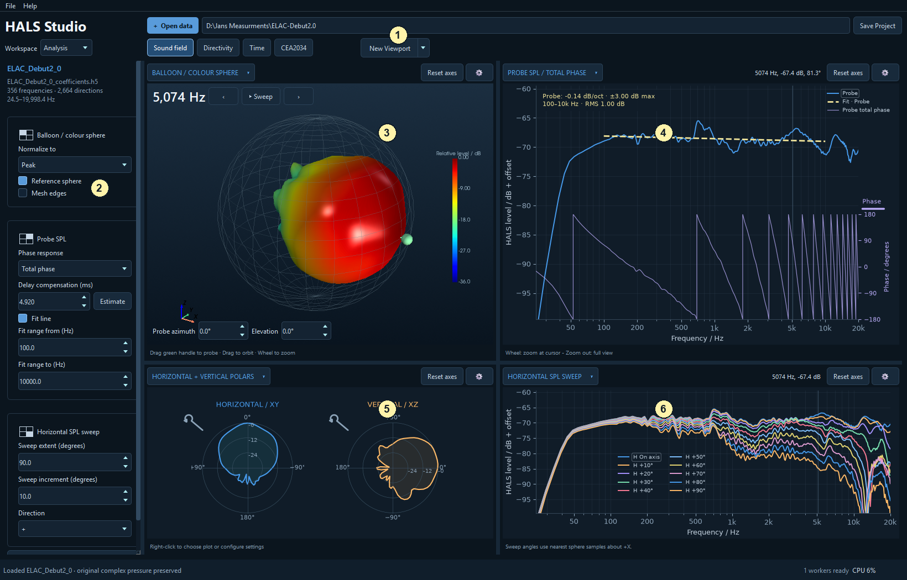
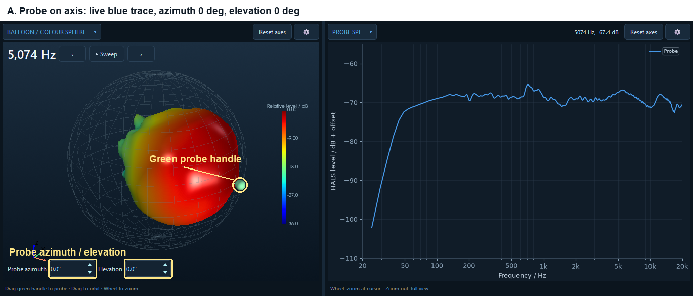
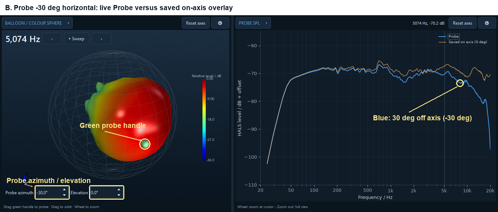
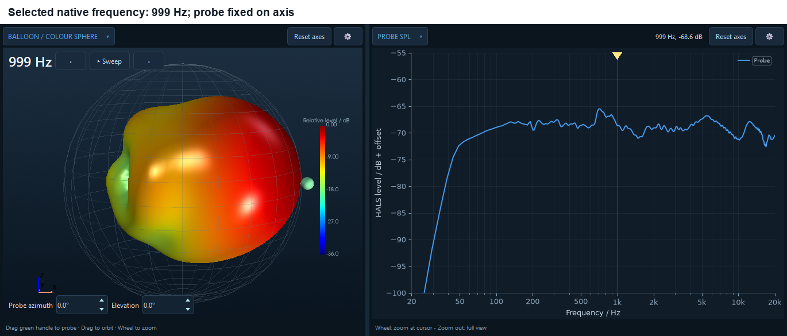
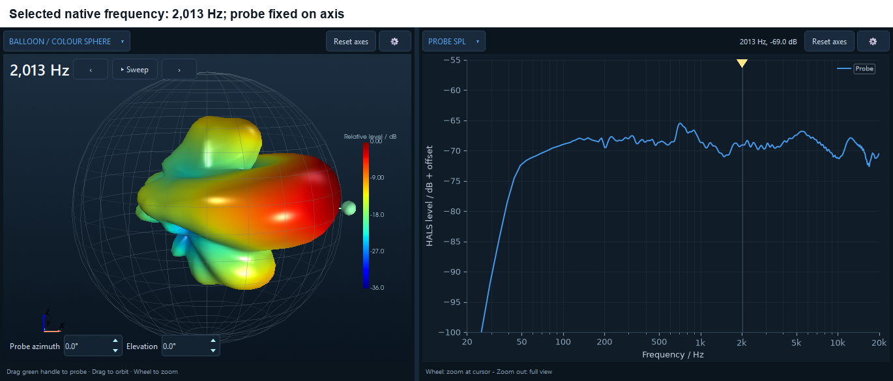
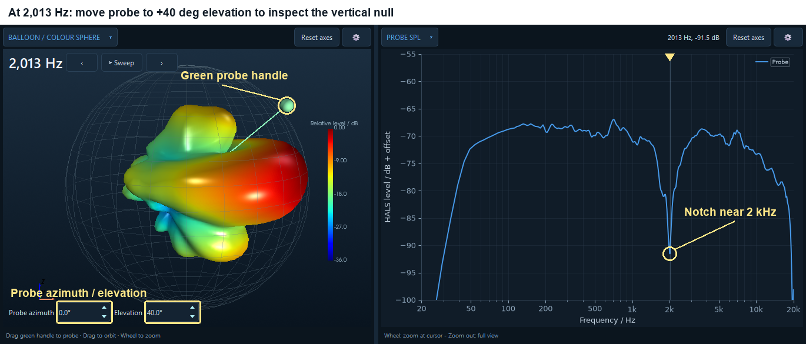
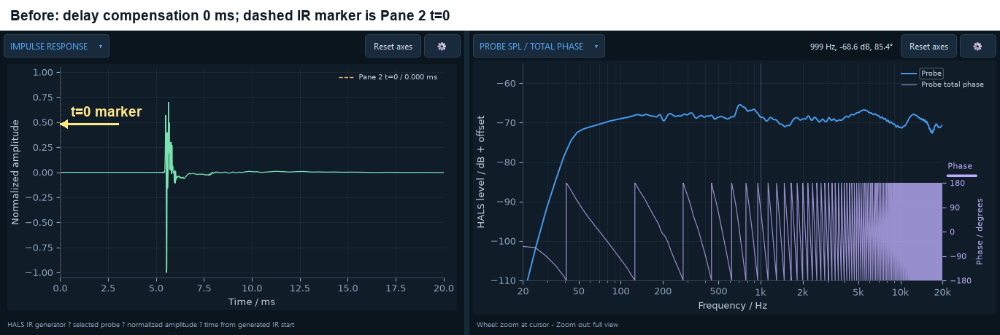
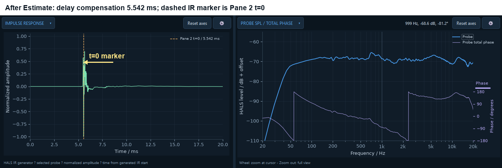
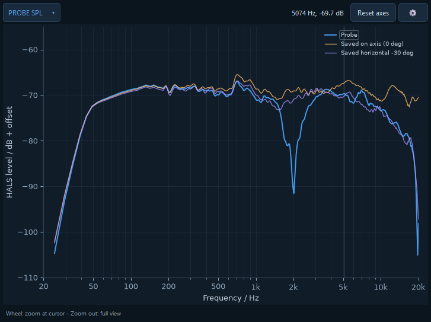
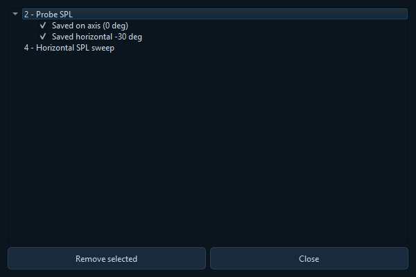

# Sound field: connect space, frequency and phase

[Workspace overview](analysis_00_workspace_overview.md) | [Sound field viewport](analysis_01_sound_field.md) | [Directivity viewport](analysis_02_directivity.md) | [Time viewport](analysis_03_time.md) | [CEA2034 viewport](analysis_04_cea2034.md)

Select **Sound field** in the Analysis viewport bar. For import settings, saved layouts, pins and shared plot controls, see the [workspace overview](analysis_00_workspace_overview.md). Examples use the ELAC Debut 2.0 dataset.

## Top left and top right: Balloon / colour sphere and Probe SPL

Treat these as a pair. The balloon shows **all sampled directions at one frequency**. Probe SPL shows **all stored frequencies at one direction**.

**Choose the frequency:** click in a frequency-response plot to move the shared frequency cursor. The balloon and single-frequency polars update to that stored frequency, and the response readout reports its level and phase. The balloon's previous/next buttons step through bins; **Sweep** animates them and **Pause** stops it. **Space** toggles sweeping, and the left/right arrow keys step frequencies. The selected frequency snaps to an available bin.

**Choose the direction:** drag the balloon's **green handle**, or type **Probe azimuth** and **Elevation** below the scene. Probe SPL then updates across the band for that direction. The probe uses the nearest reconstructed angular sample. A smaller angular step during import gives you more available directions.

Coordinates are **+X forward, +Y left and +Z up**. Probe azimuth 0°, elevation 0° points forward along +X; positive azimuth turns toward +Y, and positive elevation points upward. The displayed project **reference axis** is a separate direction used by reference-axis responses and CEA2034 calculations. Moving the probe does not redefine it.

### Example: move the probe and keep an on-axis comparison

Set **Probe azimuth** and **Elevation** to 0°. In example A, the default blue **Probe** trace shows the on-axis response; no overlay has been saved yet. Yellow annotations highlight the green handle and the two angle fields; you can drag the handle or edit those fields to move the same probe.

Before moving the probe, choose **Add overlay…** in the Probe SPL pane and name it **Saved on axis (0 deg)**. Then change only probe azimuth to **−30°**, keeping elevation at 0°. This moves the green handle toward the viewer in the example camera view.

The green handle moves to the new direction. The blue **Probe** response follows it, while the orange saved on-axis trace stays fixed. The callout **Blue: 30 deg off axis (-30 deg)** connects this changed response to the handle movement. Their high-frequency difference becomes clear. The balloon frequency, camera and response scales are unchanged between these images, with the full default **20 Hz–20 kHz** frequency range visible. Phase is hidden here to keep the magnitude comparison clear.

### Example: move the frequency cursor and keep the probe fixed

Return the probe to 0° / 0°, then click near 1 kHz and 2 kHz in Probe SPL. The yellow pointer marks the frequency cursor. These captures use the same side-view camera, normalization, colour range and response axes.

Near 2 kHz, the vertical lobes and intervening cancellations are much clearer in this side view of the tweeter/woofer crossover region. The SPL curve stays the same because the probe has not moved: only the cursor and the frequency shown by the balloon change. The labels show the actual native bins, **999 Hz** and **2,013 Hz**, rather than exactly 1,000 and 2,000 Hz.

Now keep the frequency cursor at **2,013 Hz** and move the probe into the upper vertical null: set **Probe azimuth** to **0°** and **Elevation** to **+40°**. The highlighted green handle identifies that direction on the balloon.

The blue Probe SPL curve now develops a pronounced **notch near 2 kHz**, called out at the frequency cursor. The balloon shape stays the same because the selected frequency has not changed; the handle and the frequency response change because the probe direction has moved. This completes the link: find a frequency feature in SPL, inspect its spatial directivity, then probe a lobe or null to see its effect across the full frequency response.

**Try it with the ELAC example:** select a frequency near 5 kHz, inspect the balloon and vertical polar, then move the probe above and below the forward direction. Watch how the response changes across frequency. Return the probe to 0° / 0° before comparing it with a forward-axis response.

### Read the balloon

The balloon represents radiation level, not the cabinet surface or a sound wave frozen in space. Its colour bar gives the displayed relative level range.

In its settings, **Geometry** offers **dB radius**, **Pressure radius**, or **Colour sphere (no deformation)**. The first two deform the surface with level; the colour sphere keeps direction geometry fixed and encodes the response through colour alone. Use **Reference sphere** for orientation, **Mesh edges** to see sampling, and **Surface finish** to adjust appearance.

**Normalize to: Peak** references each frequency to its strongest direction. **On axis** references the forward +X direction. Peak normalization makes radiation shape easy to compare; on-axis normalization makes directions louder than the forward response easier to identify. **Colour / polar range (dB)** sets the displayed depth below the reference. Values outside that range can be visually clipped.

**Colour by phase** replaces the level colours with phase. **Delay compensation (ms)** then affects that phase colouring. Settings belong to each pane, so a Probe SPL delay value does not automatically become the balloon's delay value. **Orbit mode** offers restrained azimuth/elevation rotation or a trackball camera.

### Read Probe SPL and phase

Probe SPL follows the selected probe direction. **Reference axis SPL** instead follows the project reference axis. In the title menu's **SPL / Phase** group you can select several magnitude responses together and choose phase separately: **No phase**, **Total phase**, or **Minimum phase**. **Clear magnitudes** allows a phase-only view. DI and phase are not combined in the same response selection.

**Double-click a magnitude trace's legend entry** (its label or line sample) to select it for the header cursor readout. The selected entry is outlined. The readout gives that trace's level and, where available and enabled, its phase at an actual nearby frequency sample. In horizontal and vertical SPL sweeps, the displayed phase curve also follows the selected trace. For a Probe SPL plot with complex overlays, the available phase curves can be shown together; selecting a legend entry chooses which trace the readout reports. A single click does not select the cursor trace. **Energy smoothing** smooths level data; it is not a substitute for dense frequency sampling when interpreting phase.

**Fit line** adds a trend over the chosen frequency range. Use **Fit response** to select the curve when several are present. The reported slope is per octave; the ± value is maximum deviation from the fit, not a confidence interval. The screenshot's fit is an example of this tool, not a loudspeaker specification.

### Estimate and compensate phase delay

Total phase includes propagation delay. At a few metres, this produces many wraps even when the loudspeaker's own phase behaviour is relatively simple.

1. For reliable estimation and unwrapping, use **All native bins · phase / delay** in import settings.
2. Open the Probe SPL gear and choose **Total phase**.
3. Beside **Delay compensation (ms)**, click **Estimate**. You can pin this control and its Estimate button to the sidebar.
4. Inspect the result, then adjust the delay manually if needed. Turn off **Wrap phase at +/-180 degrees** to inspect the continuous phase trend.

Estimate fills the delay value using the **reference-axis excess group-delay estimate**, using the same helper as Stage 5. It is based on the reference direction, even when the probe is elsewhere. Positive compensation removes the corresponding delay from displayed total phase; it does not change SPL magnitude or remove propagation time from the underlying field.

### See the delay reference move on the impulse response

Enable an **Impulse response** pane using its title menu, or select the **Time** viewport. Leave Probe SPL showing **Total phase**. The impulse plot displays a dashed **Pane 2 t=0** marker for the top-right response pane; other visible total-phase panes can contribute their own markers.

Both delay examples use **probe azimuth 0° / elevation 0°**, the native-bin Stage 5 forward response, and the full **20 Hz–20 kHz** frequency range. With **0 ms** compensation, the marker is at the left edge, at 0 ms. With the estimated **5.542 ms**, it moves right, close to the main impulse arrival; the total phase loses most of its propagation slope. Yellow arrows identify the marker. The IR waveform and SPL magnitude remain unchanged. Editing delay manually moves the marker to that value in milliseconds, making the phase reference easy to compare with the arrival. The estimate is not guaranteed to coincide exactly with the largest IR sample.

### Choose a consistent time reference

Removing time of flight does **not necessarily produce the flattest phase slope**. The loudspeaker's own drivers, crossover and acoustic behaviour can leave a natural phase slope after propagation delay is removed. Flattening the plot as much as possible is therefore not, by itself, a reliable way to choose the delay.

There is no universally agreed visual position for the “correct” **t=0** marker on a loudspeaker impulse response. Different conventions place it at the first sound arrival (where the response lifts off the zero line), partway up the main peak, at the peak itself, or at a position that brings total phase closest to a calculated minimum-phase response over a chosen band. These choices answer somewhat different questions; HALS's **Estimate** is a starting reference, rather than a declaration that one visible IR feature must be time zero.

For measurements you intend to compare, the key is a **consistent delay compensation and time reference**. For responses acquired on a common timing reference, apply the same compensation to preserve their relative timing and phase. Independently adjusting every response until its phase looks flattest can erase real differences between directions or drivers. If acquisition distances or timing references differ, account for those differences explicitly and document the convention used.

### Set up the phase axis

- **Wrap phase at +/-180 degrees** keeps phase in a compact range, with jumps at the wrap boundaries. Disable it to inspect the unwrapped phase trend; use sufficiently dense native frequency bins so that unwrapping can follow the changes between samples.
- Drag the **purple handle at the top of the right-hand phase axis** to give phase more or less vertical space. The same adjustment is available as **Phase axis height (fraction)** in settings. It changes the axis height within the pane, not the delay compensation.
- **Automatic phase limits** fits the phase range. For a fixed comparison scale or a wider unwrapped view, enter **Phase minimum (degrees)** and **Phase maximum (degrees)** in the pane settings. Entering these limits disables automatic phase limits. Choose a range broad enough to contain the unwrapped response, and use the same limits across comparisons.

The estimate works with the frequencies currently loaded into Analysis. Sparse log sampling can make both estimation and phase unwrapping misleading. The workspace overview screenshots use log-target sampling for spatial exploration; do not read their high-frequency wrapped phase as a dense-bin diagnostic. A delay can also need manual adjustment for the question you are investigating.

**Minimum phase** is a finite-band estimate derived from magnitude. It is useful for comparison with total phase, but it is not the measured total phase with an exact delay removed, and it cannot describe every excess-phase feature.

## Bottom left: Horizontal + vertical polars

These are horizontal (XY) and vertical (XZ) cuts at the shared selected frequency. They make beam width, asymmetry and side lobes easier to compare than a perspective balloon view. Read the angular labels: rotating a display can put forward 0° in a different screen direction.

Change frequency in Probe SPL or with the balloon controls and watch both polar cuts update. Their normalization, smoothing and dB range are pane settings. **Show sampled-angle dots** reveals the underlying angular samples. Drag a rotation handle to orient a cut conveniently; wheel zoom adjusts its radial view.

## Bottom right: Horizontal SPL sweep

This plot puts several horizontal off-axis frequency responses on one chart. Unlike the polars, it shows the complete band at several angles. It is useful for comparing forward response with progressively off-axis listening positions.

Use **Sweep extent (degrees)**, **Sweep increment (degrees)** and **Direction** (`+`, `-`, or `+/-`) to choose the curves. Smaller increments create more traces; they still use the nearest available sphere samples. These sweep angles are about +X. Choose **Vertical SPL sweep** from the title menu to investigate the vertical plane.

## Keep a response for comparison

Select the response pane and use its context-menu overlay command, or **Ctrl+A**, to add a named overlay. A saved probe trace stays available while you move the live probe. **Show saved probe overlays** controls whether overlays appear in that pane; the overlay manager lets you rename, hide or remove them. Save the project to preserve your comparison views.

Open **Overlays…** in the left sidebar to manage the saved traces. Entries are grouped by pane number and plot type: pane 2 is top right, for example.

The following comparison shows two saved overlays, **Saved on axis (0 deg)** and **Saved horizontal -30 deg**, alongside the live blue **Probe** at azimuth 0° / elevation +40°. Save each overlay with **Add overlay…** at its corresponding position, then move the live probe to +40° elevation.

Match the two saved legend names to the checked entries under **2 - Probe SPL**. The live **Probe** is controlled by its position and is not an entry in the saved-overlays list. Hiding one of these entries removes that saved curve from the comparison; checking it again restores it. The +40° vertical response includes the same crossover-region notch explored above.

Tick or untick an overlay to show or hide it, edit its name in the list, or select it and choose **Remove selected**. Removing an overlay discards that saved comparison; it does not change the live response. Probe and reference-axis overlays retain complex pressure, so they can supply phase as well as magnitude. Overlays captured from derived magnitude curves do not acquire phase data. Double-click the relevant magnitude entry in the plot legend to use that trace for the cursor readout.

[Workspace overview](analysis_00_workspace_overview.md) | [Sound field viewport](analysis_01_sound_field.md) | [Directivity viewport](analysis_02_directivity.md) | [Time viewport](analysis_03_time.md) | [CEA2034 viewport](analysis_04_cea2034.md)

<!-- help-group: analysis -->
