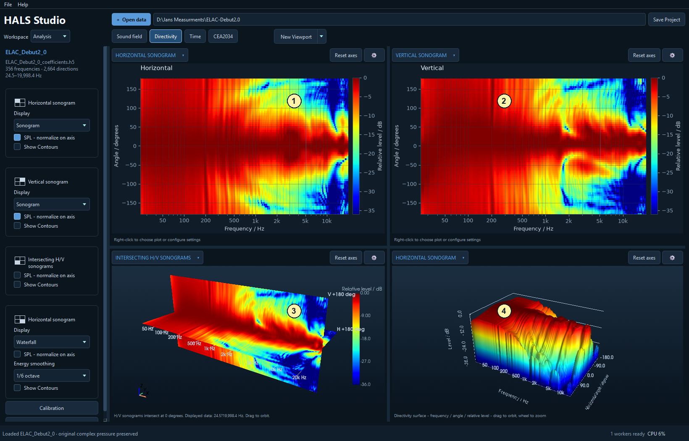

# Directivity: see how coverage changes with frequency

[Workspace overview](analysis_00_workspace_overview.md) | [Sound field viewport](analysis_01_sound_field.md) | [Directivity viewport](analysis_02_directivity.md) | [Time viewport](analysis_03_time.md) | [CEA2034 viewport](analysis_04_cea2034.md)

Select **Directivity** in the Analysis viewport bar. For import settings, saved layouts, pins and shared plot controls, see the [workspace overview](analysis_00_workspace_overview.md). Examples use the ELAC Debut 2.0 dataset.

The callouts follow reading order: **1** top left, **2** top right, **3** bottom left, **4** bottom right. All four panes show frequency-dependent directional behaviour. A **directivity waterfall** uses angle as a spatial coordinate; it is not a time-decay waterfall.

## Top left: Horizontal sonogram

Frequency runs horizontally and horizontal angle vertically. Colour encodes level. Follow a contour such as −6 dB across frequency to see how horizontal coverage narrows or widens. Look for discontinuities, off-axis lobes or asymmetric coverage.

The supplied pane enables **SPL - normalize on axis**, which references every frequency to its forward response. Disable it to inspect the unnormalized level pattern. Use **Show Contours**, **Contours Step / dB**, **Colour / polar range (dB)** and frequency limits to reveal the detail you need.

## Top right: Vertical sonogram

This is the same kind of map in the vertical plane. It is particularly useful for following crossover lobing and differences above and below the forward direction. Compare its contour pattern with the horizontal map using matching normalization and colour range.

## Bottom left: Intersecting H/V sonograms

Choose **Directivity ? Intersecting H/V sonograms** from a pane's plot-type menu.

The horizontal and vertical maps meet in a 3D scene along the frequency axis. Orbit the scene to see how the two planes relate. This combines two planar cuts, rather than displaying every direction of the spherical field. Use its own gear to match normalization, smoothing, frequency limits and contours to the other maps.

## Bottom right: Horizontal sonogram in Waterfall display

The shipped fourth pane uses **Display: Waterfall**. It presents frequency, angle and level as a 3D surface, making ridges and off-axis changes easier to see. Orbit and zoom the scene, or choose **Sonogram** in settings to return to a flat colour map. The vertical sonogram also offers these display choices.

[Workspace overview](analysis_00_workspace_overview.md) | [Sound field viewport](analysis_01_sound_field.md) | [Directivity viewport](analysis_02_directivity.md) | [Time viewport](analysis_03_time.md) | [CEA2034 viewport](analysis_04_cea2034.md)

<!-- help-group: analysis -->
