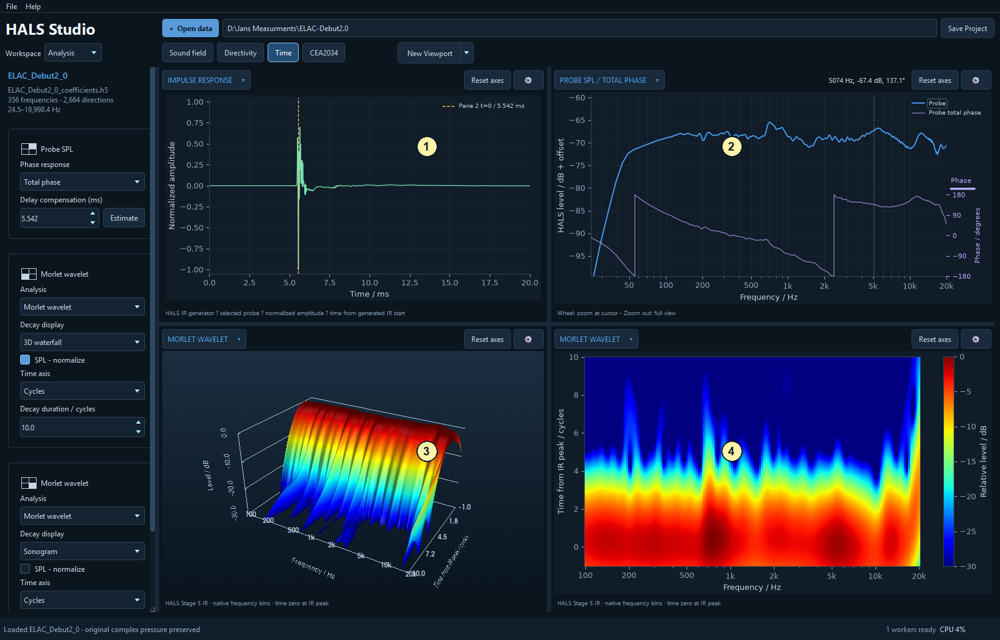
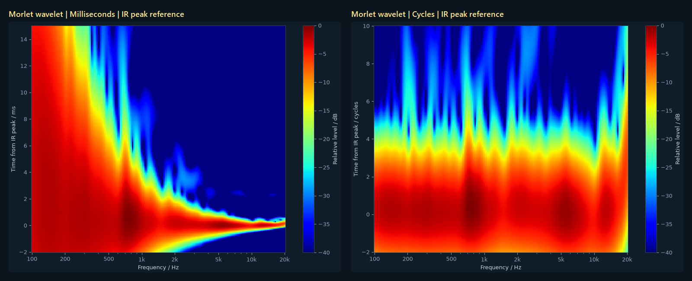
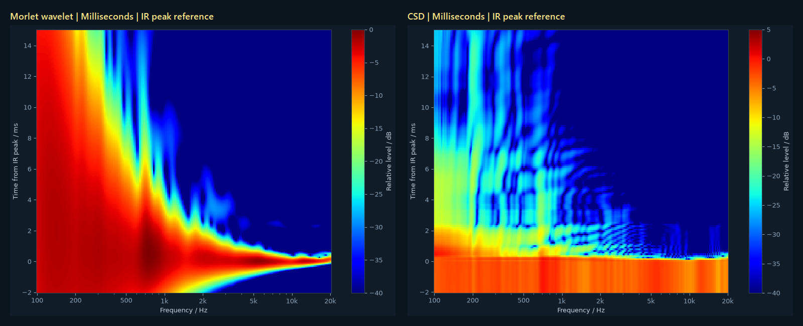

# Time: relate the response to arrival and decay

[Workspace overview](analysis_00_workspace_overview.md) | [Sound field viewport](analysis_01_sound_field.md) | [Directivity viewport](analysis_02_directivity.md) | [Time viewport](analysis_03_time.md) | [CEA2034 viewport](analysis_04_cea2034.md)

Select **Time** in the Analysis viewport bar. For import settings, saved layouts, pins and shared plot controls, see the [workspace overview](analysis_00_workspace_overview.md). Examples use the ELAC Debut 2.0 dataset.

The time plots follow the selected probe direction. When a coefficient file is available, HALS evaluates a native-bin response at that position through its Stage 5 IR generator; the sparse frequency selection used for the spatial sphere is not interpolated to invent an IR. An imported sphere without accessible coefficients must contain uniformly spaced native bins for IR analysis. If a time pane reports that native bins are required, open the original project or coefficients.

## Top left (1): Impulse response

This shows normalized amplitude against time from the generated IR start. Use it to inspect arrival shape and later energy. It retains physical time of flight. Dashed **Pane … t=0** markers identify the delay compensation of visible total-phase response panes; adjusting that delay moves the marker rather than shifting the IR itself.

Use middle-drag, wheel zoom and **Reset axes** to inspect the arrival. The impulse pane has no additional pinnable plot settings.

## Top right (2): Probe SPL / total phase

This is the frequency-domain partner to the impulse plot. Use the [delay-estimation workflow in the Sound field guide](analysis_01_sound_field.md#estimate-and-compensate-phase-delay), and compare its time-zero marker with the impulse arrival. The magnitude and phase controls are independent of those in the Sound field viewport.

## Bottom left (3): Morlet wavelet, 3D waterfall

The supplied pane shows a Morlet wavelet analysis as a 3D waterfall with time in **cycles**. A ridge that persists after the main arrival suggests energy continuing at that frequency. The default pane enables **SPL - normalize**, referencing each frequency to its own wavelet peak so that decay can be compared despite differences in response level.

## Bottom right (4): Morlet wavelet, Sonogram

This shows the same type of analysis as a flat frequency/time colour map. The supplied pane leaves **SPL - normalize** off, preserving relative level differences between frequency bands. Thus the two default bottom panes differ in normalization as well as display format; match their settings for a direct comparison.

## Switch between milliseconds and cycles

Open a time pane's **gear**, then change **Time axis** between **Milliseconds** and **Cycles**. Both Morlet wavelet and CSD offer these units. For easier repeated comparisons, pin **Time axis**, **Analysis** and the duration controls to the sidebar.

**Milliseconds** shows elapsed time directly: a horizontal time coordinate means the same delay at every frequency. Use it to compare the arrival of different frequency bands, inspect group-delay differences, or relate a feature to the impulse response.

**Cycles** measures time in periods of each frequency: cycles = time in seconds × frequency in Hz. One cycle lasts **10 ms at 100 Hz**, **1 ms at 1 kHz**, and **0.1 ms at 10 kHz**. This makes it easier to compare how many oscillations energy takes to decay at different frequencies. A fixed number of cycles represents a longer time at low frequencies and a shorter time at high frequencies; a horizontal line in the cycles display therefore does not represent one common elapsed time.

The screenshots show the same response at **probe 0° / 0°**, using a **15 ms** duration on the left and **10 cycles** on the right. These are different viewing windows, not identical endpoints converted with a single scale factor. After switching units, check **Decay duration** and **Pre allowance**, whose controls use the selected units. Disable **Auto time to dB floor** when you want to choose a fixed duration.

## Switch between Morlet wavelet and CSD

In the same pane settings, change **Analysis** to **Morlet wavelet** or **CSD**. Either method can use **Sonogram** or **3D waterfall** under **Decay display**. Keep the time units, time reference, frequency range and decay range consistent when comparing methods.

**Morlet wavelet** follows localized energy in frequency and time. Its analysis window scales with frequency: lower frequencies need a longer time window to resolve their oscillations. This is useful for viewing frequency-dependent arrival and how energy develops and decays. **Resolution (higher = narrower bands)** trades better frequency separation for less precise time localization. A feature's visible time width includes that analysis-window width, as well as the loudspeaker's behaviour.

**Cumulative spectral decay (CSD)** calculates the spectrum of the impulse-response tail remaining after a progressively later gate. Each time slice asks, “What spectral energy remains after this point?” It is useful for identifying persistent resonances and comparing their decay. It is a sequence of residual-tail spectra rather than a map of instantaneous energy, so its ridges and levels need not match a wavelet plot one for one.

In these examples, both methods use milliseconds, the **IR peak** as the time reference, the same frequency limits and a 40 dB display range. **SPL - normalize** is off in both. Their overall level references are method-specific; compare the persistence and structure of features rather than treating identical colours as identical absolute energy. Enable normalization when you want to compare decay independently of each frequency's initial or peak level: Morlet references each band's peak, while CSD references its time-zero slice.

For optional background on these general measurement-analysis methods, see Room EQ Wizard's guides to [waterfalls and CSD](https://www.roomeqwizard.com/help/help_en-GB/html/graph_waterfall.html) and [wavelet spectrograms](https://www.roomeqwizard.com/help/help_en-GB/html/graph_spectrogram.html). These explain the analysis principles; their software controls differ from HALS.

## Why show a little negative time?

**Pre allowance** extends the plot a small distance before its chosen time-zero reference. The default IR-peak reference is a convenient landmark, but it is not necessarily the first arrival at every frequency. Drivers, crossovers and acoustic paths can have different group delays, so high- and low-frequency energy can arrive at different times across the allowance around the main peak. Neither band must always arrive first.

If the display began strictly at zero, it could cut off the leading part of a band's arrival and make the response look incomplete. A small negative allowance lets you see that earlier energy as well as the later decay. The examples include **2 ms** or **2 cycles** before zero. Increase the allowance if a feature runs into the negative-time boundary; remember that a fixed allowance in cycles corresponds to different milliseconds at each frequency.

Negative plotted time means **before the selected reference**, not before the loudspeaker physically emitted sound. A centred wavelet window also spreads a response feature to both sides of its centre, so not all visible pre-zero energy proves an earlier physical arrival. In CSD, a negative-time slice starts the residual-tail gate before the IR peak, retaining the leading part of the response. For investigating arrival differences, leave **Time - normalize to peak arrival** off: enabling it in Morlet aligns each frequency to its own peak and hides those relative arrival differences.

## Choose the decay settings deliberately

| Setting | How to use it |
| --- | --- |
| **Analysis** | Switch between **Morlet wavelet** and **CSD**. Wavelets show localized energy with a frequency-dependent time resolution. Cumulative spectral decay examines the spectra of progressively later IR tails. |
| **Decay display** | Choose **3D waterfall** or **Sonogram** for either method. |
| **Time axis** | **Milliseconds** compares elapsed time directly. **Cycles** expresses time in periods of each frequency: one cycle is 10 ms at 100 Hz and 1 ms at 1 kHz. |
| **Resolution (higher = narrower bands)** | Morlet resolution trades narrower frequency bands against broader time resolution. A broad time feature alone is not proof of ringing. |
| **SPL - normalize** | For Morlet, references each frequency to its peak; for CSD, references it to the time-zero slice at that frequency. With it off, level differences across frequency remain visible. |
| **Time - normalize to peak arrival** | In Morlet, aligns each frequency to its own peak. This helps compare decay shape but hides differences in arrival time between bands. |
| **Pre allowance / Decay duration** | Sets how much time before and after the reference to show, in the chosen units. |
| **Auto time to dB floor / Decay range / dB** | Fits the useful time interval to the chosen visible decay floor. Disable automatic time when you need a fixed duration for comparisons. |
| **Frequency minimum / maximum** | Restricts the analysis to the band of interest. |

CSD uses the IR peak as its time reference. The default wavelet panes also use the IR peak until per-frequency time normalization is enabled. Read the axis label to confirm the reference. Time plots describe the processed HALS model and its available bandwidth; windowing, filtering and analysis resolution influence their appearance.

[Workspace overview](analysis_00_workspace_overview.md) | [Sound field viewport](analysis_01_sound_field.md) | [Directivity viewport](analysis_02_directivity.md) | [Time viewport](analysis_03_time.md) | [CEA2034 viewport](analysis_04_cea2034.md)

<!-- help-group: analysis -->
