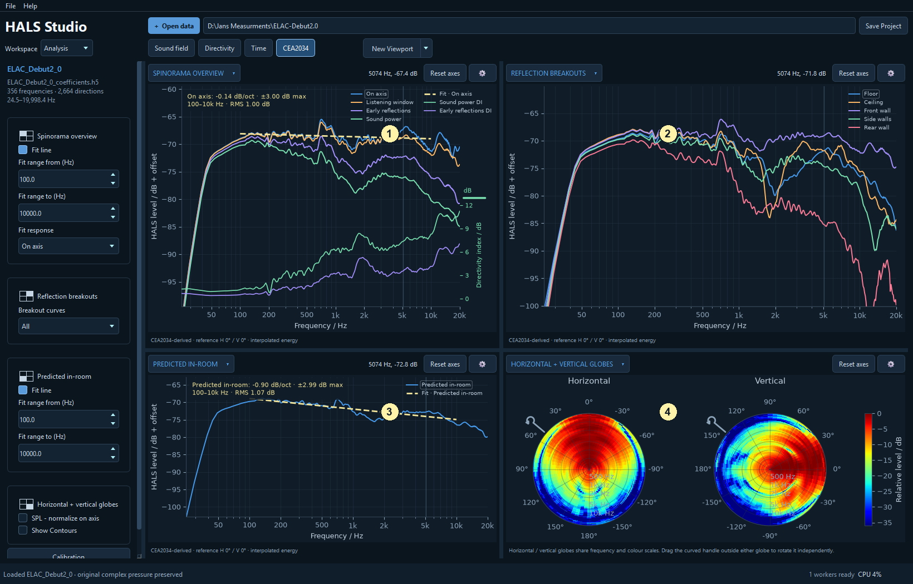

# CEA2034: connect directional behaviour to summary curves

[Workspace overview](analysis_00_workspace_overview.md) | [Sound field viewport](analysis_01_sound_field.md) | [Directivity viewport](analysis_02_directivity.md) | [Time viewport](analysis_03_time.md) | [CEA2034 viewport](analysis_04_cea2034.md)

Select **CEA2034** in the Analysis viewport bar. For import settings, saved layouts, pins and shared plot controls, see the [workspace overview](analysis_00_workspace_overview.md). Examples use the ELAC Debut 2.0 dataset.

These are **CEA2034-derived estimates from the reconstructed sphere**, using the project reference axis, energy interpolation and power averaging. They are useful summaries of the HALS model. They are not a separate set of physical room measurements or an automatic claim of standards compliance.

## Top left (1): Spinorama overview

The overview brings together **On axis**, **Listening window**, **Early reflections**, **Sound power**, **Predicted in-room** and the corresponding directivity-index curves. Compare the overall shape of the listening-window response with sound power and early reflections. Differences help explain how directional radiation may affect the balance of reflected sound.

**Sound power DI** expresses the on-axis response relative to spatially averaged sound power; **Early reflections DI** compares listening window with early reflections. DI is a level difference, so an overall SPL offset does not move it. Check its separate scale when shown alongside magnitude curves.

## Top right (2): Reflection breakouts

These separate the floor, ceiling, front-wall, side-wall and rear-wall contributions used in the summary. Use **Breakout curves** to select all, horizontal or vertical groups. The curves describe directional averages associated with reflection paths; they do not simulate the dimensions, absorption or furniture of your particular room.

## Bottom left (3): Predicted in-room

This gives the predicted in-room summary its own larger plot. Use it to compare broad spectral balance with the listening-window response. Its prediction is derived from the loudspeaker's directional behaviour, rather than measured at a listening seat.

## Bottom right (4): Horizontal + vertical globes

The two circular frequency/angle maps place the horizontal and vertical cuts side by side. Unlike a polar plot, each globe includes the frequency dimension. Read the frequency and angular labels, and drag the rotation handle if another orientation is easier to compare. Use the gear to control on-axis normalization, frequency range, smoothing, contours and colour range.

In the **CEA2034** title menu, select individual summary or breakout curves to build your own comparison pane. Multiple magnitude selections are supported; CEA2034 panes do not offer phase because these spatial power averages are not a single complex-pressure measurement.

[Workspace overview](analysis_00_workspace_overview.md) | [Sound field viewport](analysis_01_sound_field.md) | [Directivity viewport](analysis_02_directivity.md) | [Time viewport](analysis_03_time.md) | [CEA2034 viewport](analysis_04_cea2034.md)

<!-- help-group: analysis -->
