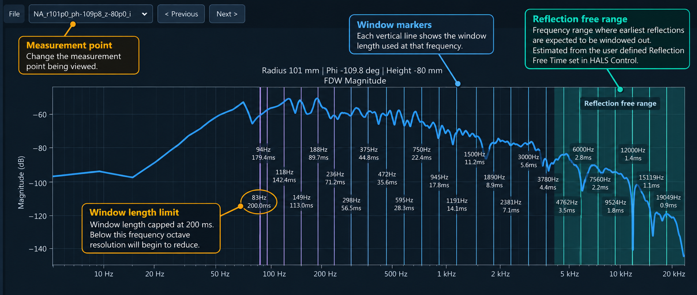
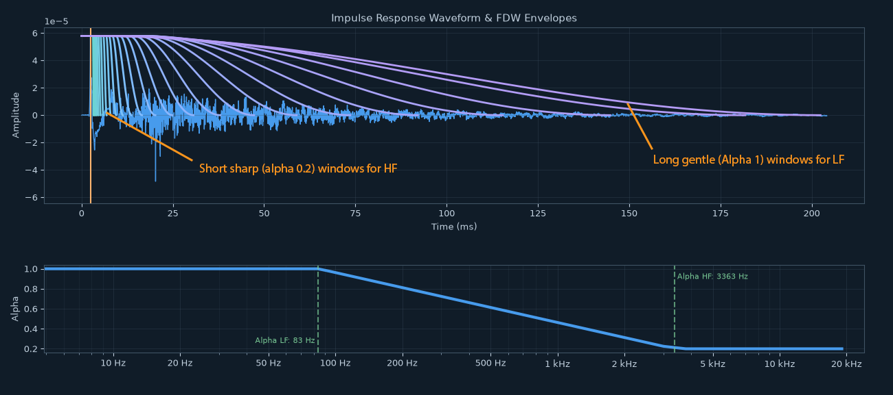

# Stage 1 Help - FDW & Smoothing

Stage 1 turns your captured impulse response WAV files into a single complex frequency-domain dataset for the rest of the HALS processing pipeline. In the app, this is the **Stage 1: FDW & Smoothing** tab.

This help file covers:

- **Usage Guide:** what to put where in the app, what each setting does, and what to check after running.
- **Understanding the Processing:** how full-band FDW and complex smoothing work.
- **Opening Recordings Without a Project JSON:** importing WAV files and handling missing metadata.

---

## Usage Guide

### What Stage 1 Does

Stage 1:

- finds the direct sound arrival in each impulse response
- applies Frequency Dependent Windowing (FDW)
- applies complex smoothing
- saves the processed complex pressure data for later stages
- opens the interactive FDW viewer when processing finishes to view the results

The output from Stage 1 is used by Stage 2, Stage 3 and Stage 4.

Stage 1 in the app does not apply normalization or auto gain, preserving the recorded level scale for SPL calibration.

### Why We Do This

FDW and complex smoothing prepare the measurements for later processing, including spherical harmonic expansion (SHE). They reduce the influence of room reflections and smooth interference patterns such as comb filtering, helping the later stages fit the sound field.

### Input And Output Files

Stage 1 expects the current project folder to contain one of these folders:

- `project_folder/measurement_set`
- `project_folder/recordings`

The WAV filenames should include the measurement position using the HALS coordinate convention:

```text
anything_r<radius_mm>_ph<azimuth_deg>_z<height_mm>.wav
```

For example:

```text
point001_r300_ph-45p5_z120.wav
```

The app uses these filenames later to recover each microphone position. The `p` character is used as the decimal point in coordinate values, so `ph-45p5` means -45.5 degrees. Files captured by the HALS Capture app should already follow this convention.

When you click **Run Stage 1**, the app creates:

- output folder: `project_folder/outputs`
- main output file: `project_name_complex_data.npz`

The NPZ records the Stage 1 processing settings used for that run, so they stay attached to the data, even if the project file is lost or the project settings are later changed.

### Quick Start

For a normal first run:

1. Open an existing `*_project.json` file created by the HALS Capture app.
2. Set **Octave Resolution (1/x)** for the frequency resolution you want. Lower values use shorter windows, which can exclude more reflections and reduce the burden on later sound field separation.
3. Set **Max Window Cap (ms)**. A value of `200-400` is suitable for most datasets.
4. Click **Run Stage 1**.

Stage 1 progress appears in the console pane. The results viewer opens when processing completes. Use it to check that the processed data looks reasonable; these results are an intermediate step in the HALS speaker measurement process.

### Results





### Main Settings

#### Octave Resolution (1/x)

The target FDW resolution, expressed as a fraction of an octave.

Examples:

- `3` = 1/3 octave
- `6` = 1/6 octave
- `12` = 1/12 octave
- `24` = 1/24 octave

Higher values of `x` in `1/x` octave require more cycles and therefore longer windows at each frequency. This preserves finer frequency detail, but can admit more reflections. It also moves the lower edge of the reflection-free frequency range upward, leaving more work for later sound field separation.

Lower values use shorter windows, which can exclude more reflections at the cost of frequency resolution. Stage 3 also uses the reflection-free range to help select SHE solve settings. See [Reflection-Free Time and the Test Range](stage3_help.md#reflection-free-time-and-the-test-range).

#### Max Window Cap (ms)

The maximum allowed FDW window length at low frequencies.

FDW requires very long windows at low frequencies to maintain the target octave resolution, but this can substantially increase processing time in Stage 4. This cap prevents the low-frequency window from becoming extremely long.

A cap of `200-400 ms` is a practical starting point.

### Advanced Settings

Click **Show Advanced Settings** to reveal these controls.

#### Enable Smoothing

Turns complex frequency-domain smoothing on or off. Enabled by default.

For normal HALS processing, leave this enabled. Turn it off when you want to inspect or compare the raw FDW result. With smoothing disabled, the complex-smoothing pass is skipped.

#### Smoothing Octave Res (1/x)

The fixed octave resolution of the complex smoothing pass.

Stage 1 has two smoothing effects. FDW naturally smooths the response through time windowing. Complex smoothing is a separate pass that averages the complex response, affecting both magnitude and phase.

`Auto` means the app uses twice the FDW octave-resolution denominator. For example, if **Octave Resolution (1/x)** is `12`, the base complex smoothing is `24` (1/24 octave). This adds a light touch of complex smoothing where windowing already provides most of the smoothing.

#### Alpha HF / LF

Alpha controls how abruptly the time window closes. A lower value gives a more rectangular window, which retains more of the signal within the window but can increase spectral leakage and ringing. A higher value gives a smoother taper, which reduces leakage but also softens the effective time cutoff.

Set separate alpha values for high and low frequencies; the value transitions gradually between them.

- `0.0` = rectangular
- `1.0` = Hann

#### Windows per Octave

Controls how many FDW analysis windows are generated per octave.

The default `3` gives smooth transitions without excessive processing cost. Increasing it can make the window schedule more finely sampled, but processing takes longer.

Each window is smoothly crossfaded in the complex domain, so the result does not stair step from one window length to the next regardless of the number of windows used.

#### Peak Detect Threshold (dB)

Controls how Stage 1 chooses the direct sound peak.

The detector finds the loudest peak, then searches earlier in the impulse response for significant peaks above this threshold. This helps because while the loudest peak is usually the direct sound arrival, it is sometimes a reflection, which places the window in the wrong place.

The default `-12.0 dB` means an earlier peak can be accepted if it is within 12 dB of the loudest peak.

The FDW results viewer shows the IR waveform and the detected peak for user inspection.

If the window aligns too late, try a more negative value such as `-18`. If it locks onto noise before the true impulse, try a stricter value such as `-6`.

#### Keep Raw & Smoothed

When off, Stage 1 saves the final selected result to the main NPZ file.

When on, Stage 1 saves both:

- raw FDW data: `project_name_complex_data.npz`
- smoothed FDW data: `project_name_complex_data_smoothed.npz`

Use this when comparing settings for debugging issues. Leave it off for a normal workflow.

---

## Understanding FDW: Windowing as Smoothing

In standard gated measurements, we use a fixed-length window (e.g., 5 ms). However, the relationship between that window length ($T$) and our frequency resolution is governed by how many wave cycles ($m$) can actually fit inside it.

Because low frequencies have long wavelengths, a fixed window captures fewer cycles as the frequency drops. This makes a standard window a "frequency-variant" process: you get high resolution at the top end, but very little at the bottom.


To achieve a specific octave resolution, the window must capture a minimum number of cycles for any given frequency ($f$):

$$T(f) = \frac{m}{f}$$

For example, 1/3-octave resolution requires approximately 4 cycles, while 1/12-octave resolution requires approximately 17 cycles. At 1 kHz, these correspond to windows of about 4 ms and 17 ms.


### The Reflections vs. Resolution Trade-off

* **A Long Window:** Captures more cycles per frequency. This provides high resolution and better detail but risks letting in room reflections.
* **A Short Window:** Captures fewer cycles. This keeps the measurement "clean" of reflections but results in a smoothed, lower-resolution plot.

### The FDW Approach

Most acoustic analysis benefits from constant octave resolution (e.g., 1/6th octave) across the entire spectrum. Instead of using a fixed time window that provides inconsistent resolution, FDW varies the window length based on the frequency being measured.

By keeping the number of cycles ($m$) constant, the window automatically shrinks at high frequencies to stay tight and expands at low frequencies to capture enough wave cycles. This allows us to exclude as many reflections as possible while maintaining a consistent resolution across the entire sweep.


---

### Practicality

Calculating a separate windowed FFT for every frequency bin would be computationally expensive. Stage 1 instead uses a bank of windows and blends their complex responses to provide smooth transitions between window lengths.

#### The Solution: Multi-Window Interpolation

To solve this, the practical approach uses a series of overlapping windows rather than an infinite number of unique ones.

- **A Bank of Windows:** The software generates a number of windows (e.g., 3 per octave, from long to short).
- **Complex Data Processing:** It calculates the complex data (both the Real and Imaginary parts, which represent Magnitude and Phase) for these windows.
- **Interpolation:** The software then interpolates across these windows.

This produces a smoothly varying mix, where the transition from one window length to the next is seamless. The result is a measurement with near-constant octave resolution that maintains its phase coherence, giving you an optimally windowed look at the DUT response with minimal reflections.

---

### Understanding Complex Smoothing: Magnitude vs. Phase

#### Why Magnitude-Only Smoothing Is Not Used Here

Typical smoothing in acoustic software is magnitude-only. The software simply averages the peaks and dips of the SPL curve. While this makes a graph look pretty and easier to read, it is intended for visual purposes only.

HALS needs both magnitude and phase for later processing. Smoothing only the magnitude changes one part of that complex response while leaving the other untouched. Complex smoothing processes both together.
#### The Solution: Complex Frequency-Domain Smoothing

To keep the measurement representing physical reality, we must use Complex Frequency Domain Smoothing.

Think of the Complex Domain as a way to describe the full signal where phase and magnitude are joined at the hip. In technical terms, this data is represented by Real and Imaginary parts. (I created a fun interactive script to help understand complex frequency domain [Complex Visualizer](https://github.com/dfapinov/lah-scanner/blob/66cfdf15742e616362d79e6079e99741fabb2889/process/complex_visualizer.py))

By applying smoothing to the Real and Imaginary parts simultaneously, we smooth the overall response while maintaining the physical relationship between magnitude and phase.

### The Bonus Effect: Reflection Rejection

Beyond just making the data easier to process, Complex Smoothing provides a secondary, powerful benefit: it further cleans the measurement of room reflections.

#### Direct Sound and Delayed Reflections

This works because of the fundamental difference between the direct sound and a reflection bouncing off a wall:

* **The Direct Sound:** After time alignment, its complex response generally varies more slowly across nearby frequencies, so it tends to survive the averaging.
* **The Reflection:** Its additional delay causes its phase to rotate with frequency. When that rotation is large enough across the smoothing window, its complex contributions tend to cancel.

Complex smoothing averages the real and imaginary components together, rather than averaging phase angles directly.

* **Slowly varying components** tend to remain strong across the smoothing window.
* **Rapidly rotating components** tend to average to a smaller value. The amount of suppression depends on the delay and smoothing bandwidth.

Complex smoothing can reduce delayed reflections while retaining the main response of the device under test (DUT).

## Opening Recordings Without a Project JSON

If a project file has been lost, is unsuitable, or is unavailable, you can open the impulse response set directly.

Use **Open data** to browse to the directory containing IR WAV files that follow the HALS naming convention. Select one file and click **Open**. Studio scans the directory and opens all WAV files with compatible filenames as a set for Stage 1 processing.

Outputs go into `outputs` in the directory above the recordings. Studio reports skipped filenames and rejects duplicate measurement positions or mixed sample rates.

Direct WAV import always starts a new project without reusing existing project settings. After Stage 1 completes successfully, Studio creates `direct_wav_import_project.json` in the parent directory. If the name is already in use, it chooses a numbered name such as `direct_wav_import_2_project.json`, preserving existing projects and their outputs. **Save Project** subsequently updates this new file.

### Missing Metadata

A project file normally supplies measurement metadata from the HALS Capture app. When opening WAVs directly, Studio handles missing metadata as follows:

- **RFT (reflection-free time):** The time between the direct sound arrival and the first boundary reflection. This guides the alpha taper transition in Stage 1 and the reflection-free range highlighted in the results. Stage 3 also uses it to suggest the lower test frequency. Without RFT metadata, Studio uses a 5 ms fallback but does not highlight a reflection-free range, because that range has not been measured. Stage 3 explains the fallback when you click **Run**. You can still set the lower test frequency manually.
- **Tweeter coordinate:** Stage 2 uses the tweeter position to seed the high-frequency acoustic origin search. Without it, Stage 2 scans the measurement cylinder at 20 mm spacing, using the highest available frequency at or below both 20 kHz and the configured search end frequency. A simplex search refines this initial estimate. The estimated tweeter coordinate is saved to the project for subsequent runs and Export visualisation.
- **Baffle and additional points:** A project can include baffle corners, a reference-axis point, and positions for drivers and ports. These provide visual guides to the device under test (DUT) in the Export viewer. Guides with missing coordinates are not rendered.

### Exporting Stage 1 IRs

For debugging and investigation, you can export processed Stage 1 IRs as WAV files. Use **Export IR...** to export the selected measurement, or the button's arrow menu to choose **Export All...**. When both FDW and smoothed curves are available, choose which version to export.

The WAVs use 32-bit floating point and the saved sample rate. They contain the processed Stage 1 data, rather than the original unwindowed recordings. This is useful for comparing the input to the SHE model with its output at the same measurement position.

<!-- help-group: process -->
