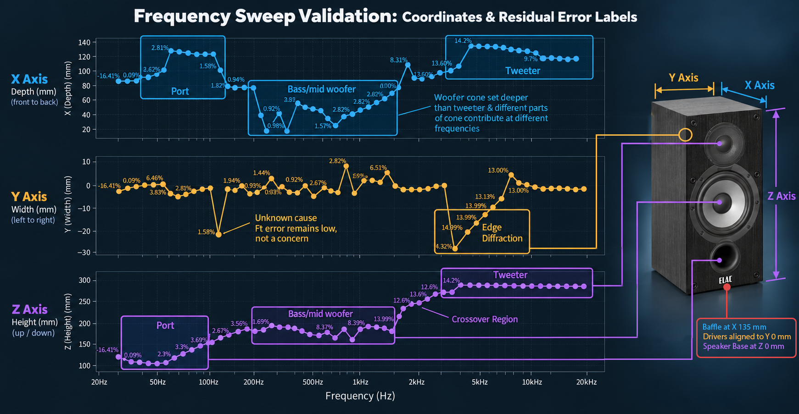
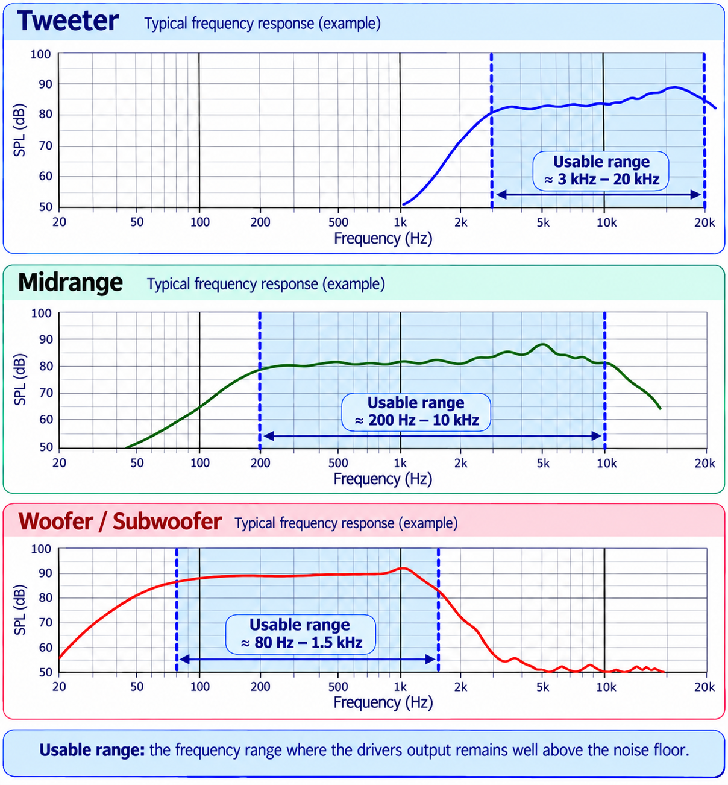

# Stage 2 Help - Acoustic Origins

Stage 2 finds a suitable acoustic origin at each tested frequency, preparing the data for the spherical-harmonic solve. In the app, this is the **Stage 2 - Origins** tab. The origin can move with frequency as different drivers, ports and other radiating surfaces contribute to the sound.

This help file is split into two parts:

- **Usage Guide:** what Stage 2 does, how to get started and how to choose the test range.
- **Understanding Acoustic Origins:** why the origin matters and how the search works.

---

# Usage Guide

## What Stage 2 Does

Stage 2 searches for an origin that lets the model reliably predict withheld microphone recordings. This method is called **leave-one-out prediction**: we judge an origin by how well the model predicts data it has not used for the fit.

The process approaches each frequency from both directions, high to low and low to high, then keeps the better result.

At low frequencies it also checks how much harmonic order is needed to describe the speaker's sound. Starting with the user-defined **Search Harmonic Order (N)**, 7 by default, it tries lower orders and chooses the lowest one that gives a similar internal field and sound power. This helps avoid using extra terms where they add little useful information.

The chosen origins and harmonic order requirements are interpolated between tested frequencies and saved in the project's complex-data NPZ for later stages. **How Do We Judge a Good Origin?** below explains the prediction and order checks in more detail.

## Why We Do This

A suitable origin lets the spherical-harmonic model describe the measured sound field with fewer terms. A fixed origin may work well for one driver or limited frequency range but less well elsewhere, particularly around a crossover or where a port becomes the main radiator. Tracking the origin helps the later solve use its available harmonic degree (order N) to describe the sound field's directivity more efficiently.

The result is a best-fit mathematical origin, which need not sit exactly on a physical driver but does typically follow the acoustic origin closely.

## Quick Start

1. Set **Lower Frequency** and **Upper Frequency** to the DUT's usable frequency range, using its measured response to avoid testing frequencies where the output is near the noise floor.
2. Check the tweeter coordinates under **HF search seed**. Leave **Search Harmonic Order (N)** at its default of 7 to begin with.
3. Run Stage 2.
4. Results always appear in the GUI. Review the origin paths and fitting errors. For example, where the tweeter dominates the output, the high-frequency origins should usually lie near its physical location.

## Results - How to interpret

When the process completes, the graphs show how the chosen X, Y and Z coordinates change with frequency. Following these paths can help you understand how different parts of the loudspeaker contribute to its sound.

In this example, the Y-axis offset is unexpected, but that alone does not mean the result is wrong. Consider the error around it, any warnings in the log, and what the speaker is doing in that frequency range. A smooth path is reassuring, but it is not a guarantee of accuracy either.

The plotted fitting error describes how closely the model matches the recordings used to fit it. The leave-one-out prediction error in the log asks a different question: how well can it predict a recording when that recording is left out? The search uses this prediction error to choose between origins.

A 3D coordinate view is available from the **Plot Type** menu. The older full-grid residual rescan is not available for leave-one-out prediction results.

The log also reports which LF orders were selected. A **provisional** warning means the search or its checks have not given a settled answer at that frequency. This can happen if the optimiser runs out of iterations, prediction is poor, or the highest tested orders still disagree. See **Choosing the LF Order** below for more about that check.

### Waypoint References

In the main **Validation** view, select individual waypoint checkboxes (such as **Tweeter**, **Port** or **Woofer**) to display their positions on the X, Y and Z graphs. The colour dash beside each checkbox matches its reference lines. These are geometric references; the optimised acoustic origin does not necessarily coincide with them.

### Graphical Editing

Enable **✎ Draw** to edit the origin coordinates graphically. Left-click and drag within an axis graph to draw a straight line. On release, the coordinates snap to the drawn line and the fitting error is recalculated.

Press **Escape**, or release the mouse outside the graph, to cancel. Disable **Draw** when finished.

**Manual edits need Save Project to apply.** Until then, coordinates and recalculated errors are an in-memory preview; the saved measurement data and origin cache remain unchanged. After saving the project, re-run subsequent processing stages to use the modified origins. Manual edits update the fitting error, but the earlier LF order checks no longer certify the edited origin. Rerun Stage 2 if you want the automatic checks applied again.

Middle-mouse drag pans the X/Y/Z graphs. Use the mouse wheel to zoom at the cursor, or wheel over an axis to zoom just that axis. **Reset axes**, beside **Save image**, restores the full view. Error labels show whole percentages and alternate above and below the line. Click a point on any axis to highlight that frequency on all three graphs. A persistent readout in the upper-left margin of the plot canvas shows the selected frequency, fit error to two decimals, and X, Y and Z coordinates in millimetres. Selection also works with Draw enabled; a click selects while a drag edits.

**When to use:** Graphical editing can help correct suspicious origin movements, particularly when strong reflections or environmental noise have pulled the fitted origin away from the DUT.

Use caution, however. Genuine acoustic effects, such as diffraction or multiple radiating surfaces, can produce unexpected but valid origin positions. Consider the physical behaviour of the DUT before making corrections.

## Main Settings

### Upper Frequency

Set the upper frequency with the device's measured response in mind, around the point where high-frequency output starts roll-off towards the noise floor.

### Lower Frequency

Set the lower frequency around the point where low-frequency output starts roll-off towards the noise floor.

Where driver output is weak, the search may start fitting environmental noise rather than the device. The resulting origins can move far from the device and cause errors in the final results.

## Advanced Settings

### Octave Resolution

Stage 2 tests frequencies spaced by a fraction of an octave rather than searching every FFT bin. **Octave Resolution (1/x)** sets that spacing: `6` tests at 1/6-octave intervals, while `12` tests at 1/12-octave intervals. Finer spacing means more searches and a longer run.

The resulting X, Y and Z coordinates are interpolated between tested frequencies to provide an origin for every FFT bin within the selected range. This assumes the effective origin changes smoothly enough between samples.

### HF Search Seed - Tweeter X, Y and Z

The initial high-frequency search position in Cartesian millimetres: X is depth, Y is width and Z is height. Captured tweeter metadata supplies these coordinates. If no tweeter coordinate is available, Stage 2 estimates a seed using a 20 mm grid inside the measurement cylinder followed by simplex refinement.

### Search Harmonic Order (N)

Sets the order used to search for origins, and the upper reference for the LF order comparisons. The default is **N=7**. A higher order can describe a more complicated sound field, but takes longer to search and needs enough independent information in the measurements. The measurement grid may limit the order below the value you enter.

This setting belongs to the origin search. **Stage 4 has its own maximum order for the final solve**, which can be higher.

### Residual Seed Pre-pass

An optional extra search to try before the leave-one-out prediction search. It uses the earlier method of finding origins from fitting error, then offers those positions as additional starting points for the new search.

Leave it off for a normal run. It can be useful if you suspect the search is getting stuck around an unhelpful starting position, but it adds processing time. The normal upward and downward searches still run, and leave-one-out prediction still decides which result to keep.

### Initial Simplex Step (mm)

Sets the initial size of the Nelder-Mead search simplex. A larger step explores a wider neighbourhood; a smaller step starts more locally around the seed.

### Max Iterations

Limits simplex optimisation steps per frequency. Increasing it gives difficult searches more time to converge, at the cost of a longer run.

### Hold Coordinate Outside Test Range - LF and HF

LF holds the lowest tested origin below the lower test frequency; HF holds the highest tested origin above the upper test frequency. Both default to on. Turning either off applies zero coordinate shift outside that side of the test range. Coordinates inside the range are still interpolated. Save Project applies these settings when committing manual edits.

### Full Grid Rescan Settings

The XYZ bounds and grid resolution belong to the older full-grid residual diagnostic. They do not control the leave-one-out prediction search, which keeps candidate origins inside the microphone grid. Full-grid rescans are unavailable for the new results.

### Excluding Suspect Recordings

Use the IR review app to inspect and rename recordings you want to exclude. **Rerun Stage 1 after renaming or replacing files**, so the NPZ used by Stage 2 contains the updated recording pool. Renaming a WAV does not remove its data from an existing NPZ.

---

# Understanding Acoustic Origins: Aligning Math with Physical Reality

In **Spherical Harmonic Expansion (SHE)**, the choice of coordinate origin affects how efficiently a sound field can be represented at a limited order N. An origin near the dominant source can reduce the order needed for a useful fit; it does not have to match an exact physical source point.

However, a loudspeaker's acoustic origin is not static; it shifts depending on the frequency being played. 
* At **10 kHz**, the sound originates from the tweeter. 
* At **100 Hz**, it originates from the woofer or a bass reflex port.

An unsuitable origin can require more terms to describe the same field. Increasing the order can also make a poorly conditioned solve more sensitive to noise and measurement errors. Tracking the origin helps reduce unnecessary complexity, although it does not by itself guarantee good conditioning.

---

## Spherical Harmonics and Order N

To understand why the origin matters, we first need to understand how Spherical Harmonic Expansion works. You may know of Fourier, who proved that a complex audio signal can be described as a sum of its component parts—simple sine waves. 

Spherical Harmonics can be thought of as a 3D version of a Fourier transform, breaking a complex 3D shape (the sound field) into a series of standardized 3D shapes (spherical harmonics, or the ‘harmonic basis’). It is like using various standardized Lego bricks to build up the complex shape of a Batman figure.

The complexity of these shapes (like simple or complex bricks) is defined by the **Harmonic Degree, or Order (N)**:

* **N=0 (Monopole):** A perfectly uniform, pulsating sphere. This is the simplest possible sound source.
* **N=1 (Dipole):** A figure-eight shape, with sound pushing forward and pulling backward.
* **N>=2 (Quadrupole and beyond):** Increasingly complex shapes with multiple lobes that describe tight, angular details in the sound field.

### Degrees of Freedom
The Lego brick analogy extends to the degrees of freedom (DOF) of each harmonic degree. A simple order is like a square brick, in that it is the same at every rotation. A complex brick like an L-piece has more DOF—it is different when rotated, flipped, or mirrored. Higher harmonic degrees also have more DOFs, so the complexity they can describe scales quickly.

In this respect, **Order N represents our spatial resolution.** Higher orders allow us to model finer, sharper details in the sound field's directivity.

---

## The Origin Problem: The "Explosion" of Complexity

Imagine a perfectly spherical, pulsating balloon (an N=0 monopole). If we place the center of this balloon exactly at the center of our mathematical universe (0,0,0), the math is incredibly simple. The SHE solver only needs the monopole term at N=0 to describe this ideal source's angular pattern.

Now, imagine we move that same balloon 1 meter to the left, but we keep our mathematical origin at (0,0,0). 

From the perspective of our mathematical origin, the balloon no longer looks like a simple, single radius. To describe this shifted balloon using math anchored at (0,0,0), the solver has to account for the near surface, the far surface, and everything in between. It is forced to use a massive combination of N=1, N=2, N=3, and so on, stacking complex "lobes" and "dents" on top of each other just to describe a simple balloon from a distant perspective.

### The Consequences of Mismatched Origins
When the acoustic origin is far from the mathematical origin, more terms may be needed. That can make two problems more difficult for separating the internal speaker source from external room reflections:

1.  **Noise Amplification:** Extra terms can start describing background noise or small measurement errors as well as useful acoustic detail. This becomes a concern when the recordings do not contain enough information to distinguish them.
2.  **Numerical Instability (Singularities):** Some combinations of terms can become difficult to distinguish from one another. Small changes in the recordings can then lead to large changes in the fitted coefficients. This is called ill-conditioning.

---

## The "Phantom" Origin and Phase Shifts

To further understand why a dynamic 3D origin search is necessary, it helps to look at how different sound sources on a loudspeaker interact. The acoustic origin isn't always a physical component you can touch; it is often a "phantom" point in space created by the summation of multiple sources or the physics of the radiator.

* **The Crossover Handover (The Mid-way Point):** When a loudspeaker transitions from the tweeter down to the woofer, the acoustic center doesn't simply jump from one to the other. Through the crossover region, where both drivers are producing the exact same frequencies at similar amplitudes, the mathematical "center" of the combined sound field may lie between the drivers, depending on their relative levels, phases and radiation patterns.
* **Rapid Shifting and Diffraction:** At the specific frequency where a bass reflex port is tuned, the port takes over as the dominant radiator, causing the origin to shift rapidly toward the opening. Furthermore, when sound waves hit the cabinet edges, those edges act as secondary radiators (diffraction). Cabinet panels may vibrate as sympathetic resonators creating further sound sources. These interfere with the direct sound, pulling the calculated acoustic origin in unexpected directions.

Because of these interactions, a single manually chosen coordinate may not be equally suitable across the full frequency range.

---

## How Do We Judge a Good Origin?

Imagine asking someone to trace a curve through a set of dots. With enough freedom, they might draw a curve that passes through every dot, including a few that are in the wrong place. A close fit alone does not tell us how well that curve describes what lies between the dots.

The same problem occurs with our measurements. An origin can give a very small fitting error while the model is also describing noise or other capture errors.

**Leave-one-out prediction** gives the search a more useful question to answer. Imagine covering up one recording, fitting the model to the others, and asking it to predict the hidden recording. We do this for every recording in turn and combine the prediction errors. The search then looks for the origin that makes those predictions work best.

All recordings take part; we do not reserve a separate 20% group in a normal run. A mathematical shortcut lets us calculate the leave-one-out errors without doing a separate solve for every recording. The statistical name for the score calculated from these prediction errors is **PRESS**, but we call the method leave-one-out prediction to make its purpose clearer.

### The 3D Simplex: Finding a Better Position

The search still uses the **Nelder-Mead Simplex** algorithm. Think of it as a small tetrahedron that moves through the possible origin positions, stretching, shrinking and turning as it finds better prediction scores.

It is good at finding a nearby minimum, but it cannot promise to find the best position everywhere. This is why we search from both ends of the frequency range, and why the optional residual seed pre-pass can sometimes help.

### Choosing the LF Order

A good origin helps us use the available harmonic terms efficiently. But at low frequencies we also need to ask whether we have allowed enough terms in the first place. A speaker with several contributing radiators may need more than the usual KR+2 rule suggests.

Stage 2 first searches at the chosen **Search Harmonic Order (N)**. Where KR+2 calls for a lower order, it then tries lower orders, allowing each one to find its own origin. It compares the resulting internal field (the speaker's outgoing sound) with the upper-order result.

We are looking for the point where adding more terms makes little useful difference. A lower order passes when:

- The internal pressure differs by no more than **5% RMS**, including phase, over a spread of 120 directions at both 1 m and 2 m.
- The internal sound power differs by no more than **1 dB**.

The comparison points stay at the same physical locations for every candidate. Stage 2 chooses the lowest passing order at or above the KR baseline. The selected order can rise or fall as the frequency changes.

The upper-order result is a reference, not a known perfect answer. Stage 2 also checks whether it agrees with the next lower tested order. If those still differ appreciably, the reference has not settled and the log calls the selection **provisional**. More search order may help, but weak output or suspect recordings can also be responsible. Where KR already reaches the search ceiling, the lower-order comparisons are skipped.

This gives us two complementary checks: leave-one-out prediction helps choose an origin that predicts the measured total field, while the LF comparison checks whether the internal reconstruction has settled enough to use fewer terms.

### Passing the Result to Stage 4

KR is calculated around the centre of the microphone grid. Moving the search origin therefore cannot gain an advantage simply by unlocking another order.

Stage 2 saves an interpolated origin path and LF order requirements for every frequency bin. Stage 4 combines these requirements with its usual KR order growth. Any optional growth optimisation at higher frequencies happens in Stage 4, leaving the LF requirements in place.

You can therefore choose a modest search order such as N=7 even when the final high-frequency solve needs a higher maximum. Stage 2 does not have to search the whole bass range at that higher order.

## Giving the Search a Useful Starting Point

At high frequencies, wavelengths are short and the origin position matters more. Giving the search the tweeter's coordinates helps it start in a useful place. It can then follow the changing sound field down through the frequency range. If those coordinates are unavailable, Stage 2 estimates a starting position from a coarse search.

### Parallel Dual-Path Search

#### 1. High-to-Low Search (HF-to-LF)
* **Initial Lock:** The algorithm begins at the highest frequencies, using the user-provided tweeter coordinates to lock onto the origin where wavelengths are smallest and most sensitive.
* **The History Seed:** The script uses the origin coordinates from the previous frequency to seed the next.
* **Path Tracking:** As the frequency drops and the origin shifts, the simplex follows the acoustic path downward.

#### 2. Low-to-High Search (LF-to-HF)
* **Initial Lock:** The algorithm begins at the lowest frequencies, starting at the measurement coordinate zero.
* **The History Seed:** Similar to the HF search, each successful solve seeds the next step upward.
* **Path Tracking:** As the frequency increases, the simplex tracks the shifting origin upward toward the crossover region and tweeter.

While each individual search branch is inherently sequential, they are independent of each other. It is therefore possible to process both in parallel on their own CPU cores, potentially reducing elapsed time compared with running both searches sequentially. 

Since each branch approaches the acoustic centre from a different starting position, they provide a "second opinion" on the origin's location. One search can occasionally find a lower error origin than the other.

Once both branches complete, the script compares the results and selects the origin with the lower leave-one-out prediction error from either path. The optional LF order comparisons follow this search.

These best-fit results are interpolated across the full frequency resolution within the selected test range.

**Hold coordinate outside test range** in Advanced Settings has separate **LF** and **HF** checkboxes on the same row. Both are on by default. LF holds the lowest tested coordinate down to the lowest data frequency; HF holds the highest tested coordinate up to the highest data frequency. For example, a last tested coordinate at 19.5 kHz is held through 24 kHz if the data extends that far.

Turning either option off applies **zero coordinate shift outside the selected test range** on that side. Interpolation inside the range is unchanged. Rerunning Stage 2, saving edited coordinates, or exporting a grid rescan applies the selected hold settings and replaces the saved origin array.

### A Note on Reported Results

The origin search and final solve can use different harmonic orders, so their fitting errors need not match. The Stage 2 plot shows the fitting error, while the log includes the leave-one-out prediction score and the LF comparisons. They answer different questions and are most useful when read together.

Unexpected origin movement is a reason to look more closely, rather than proof that a result is wrong. Check the DUT's output level, the quality of the recordings and any provisional warnings before deciding whether to change the search settings.

<!-- help-group: process -->
