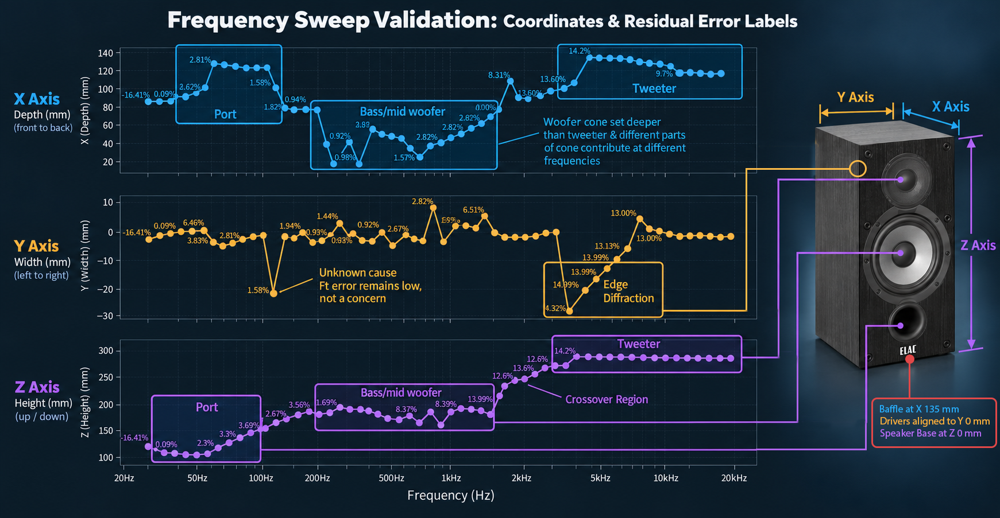
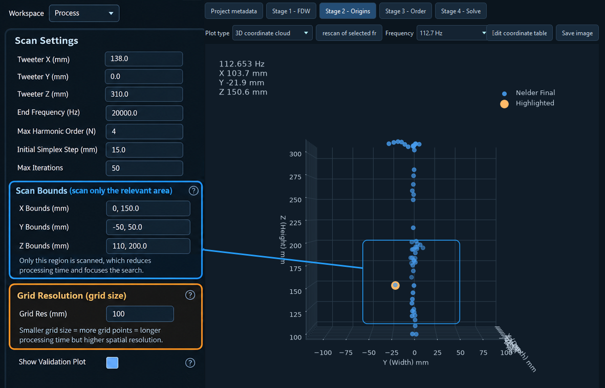
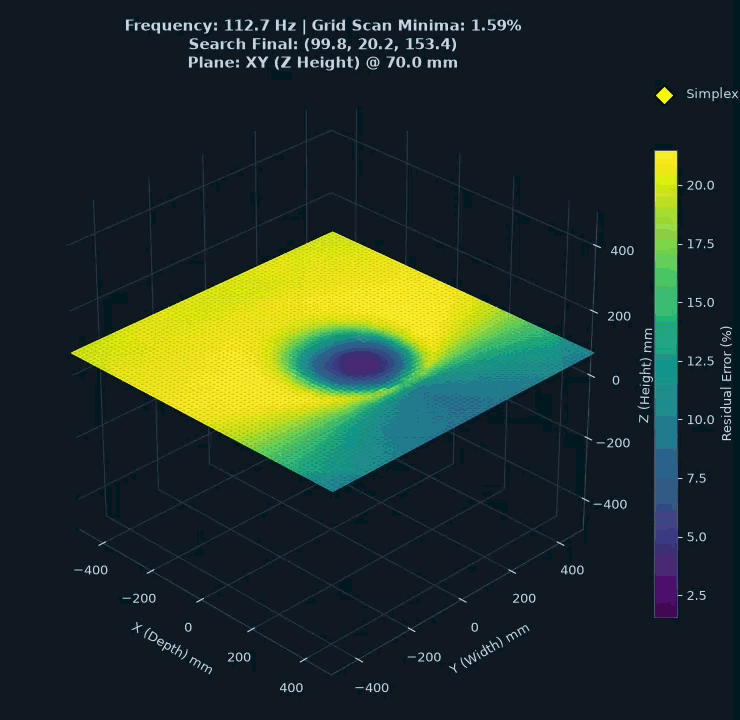
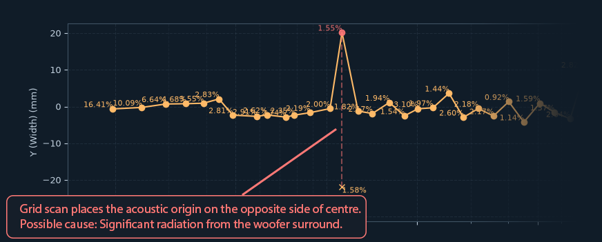
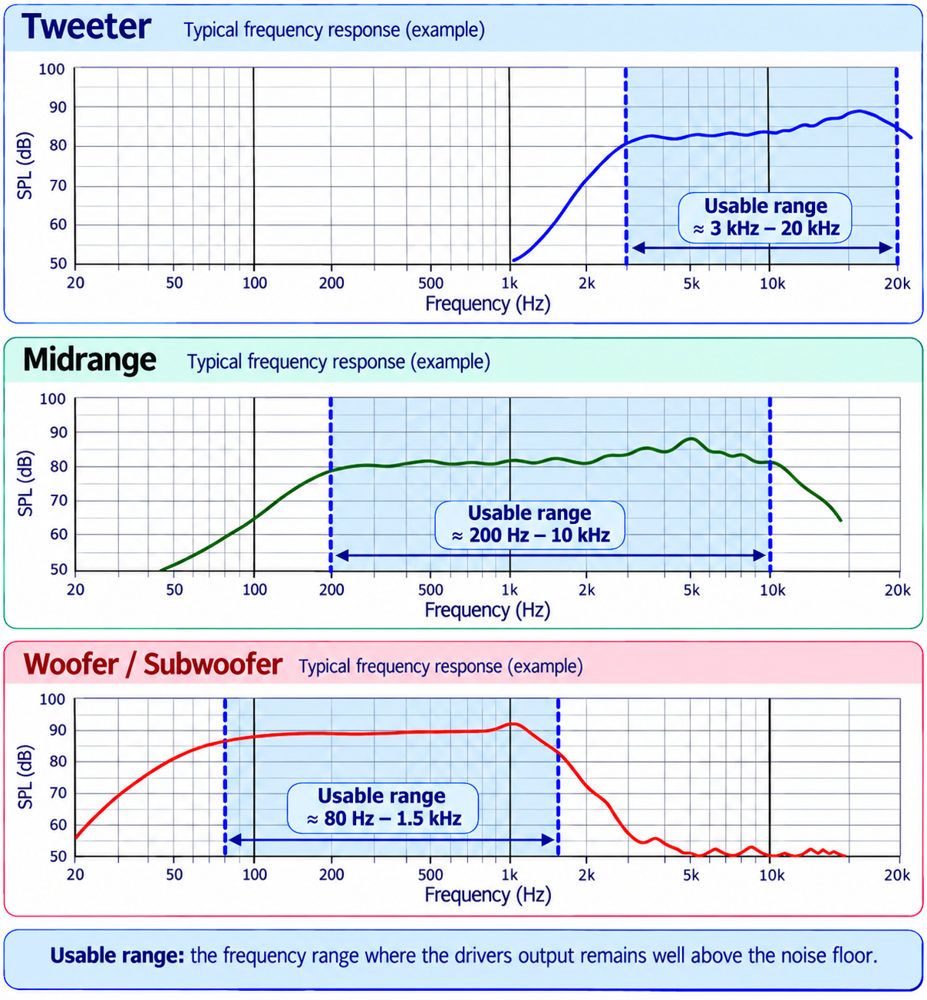

# Stage 2 Help - Acoustic Origins

Stage 2 finds a suitable acoustic origin at each tested frequency, preparing the data for the spherical-harmonic solve. In the app, this is the **Stage 2 - Origins** tab. The origin can move with frequency as different drivers, ports and other radiating surfaces contribute to the sound.

This help file is split into two parts:

- **Usage Guide:** what Stage 2 does, how to get started and how to choose the test range.
- **Understanding Acoustic Origins:** why the origin matters and how the search works.

---

# Usage Guide

## What Stage 2 Does

Stage 2 searches for the origin coordinates that give a low fitting error at each tested frequency. It compares searches running from high to low and low to high frequencies, then keeps the better result at each frequency. The selected origins are interpolated within the test range and saved in the project's complex-data NPZ for later stages.

## Why We Do This

A suitable origin lets the spherical-harmonic model describe the measured sound field with fewer terms. A fixed origin may work well for one driver or limited frequency range but less well elsewhere, particularly around a crossover or where a port becomes the main radiator. Tracking the origin helps the later solve use its available harmonic degree (order N) to describe the sound field's directivity more efficiently.

The result is a best-fit mathematical origin, which need not sit exactly on a physical driver but does typically follow the acoustic origin closely.

## Quick Start

1. Set **Lower Frequency** and **Upper Frequency** to the DUT's usable frequency range, using its measured response to avoid testing frequencies where the output is near the noise floor.
2. Run Stage 2.
3. Results always appear in the GUI. Review the origin paths and fitting errors. For example, where the tweeter dominates the output, the high-frequency origins should usually lie near its physical location.

## Results - How to interpret

One the process compeltes, the user will be presented with a graph of the 3 cartiesian axis and the coordiantes found to provide low fit error.  

Interpretation of this data can be quite enlighting about the device under test as well as help to confirm resaonable results.

The unknown Y axis offset is is intreaging but does not itself give cause for worry - the fit error remains low and in a similar range as the surrounding coordiantes.  

A 3D coordiante view is also avilible from the **Plot Type** menu, as well as **Rescan of selected frequency** - a pure grid based volumetric scan that can take considerable time.

### Waypoint References

In the main **Validation** view, select individual waypoint checkboxes (such as **Tweeter**, **Port** or **Woofer**) to display their positions on the X, Y and Z graphs. The colour dash beside each checkbox matches its reference lines. These are geometric references; the optimised acoustic origin does not necessarily coincide with them.

### Graphical Editing

Enable **✎ Draw** to edit the origin coordinates graphically. Left-click and drag within an axis graph to draw a straight line. On release, the coordinates snap to the drawn line and the fitting error is recalculated.

Press **Escape**, or release the mouse outside the graph, to cancel. Disable **Draw** when finished.

**Manual edits need Save Project to apply.** Until then, coordinates and recalculated errors are an in-memory preview; the saved measurement data and origin cache remain unchanged. After saving the project, re-run subsequent processing stages to use the modified origins.

Middle-mouse drag pans the X/Y/Z graphs. Use the mouse wheel to zoom at the cursor, or wheel over an axis to zoom just that axis. **Reset axes**, beside **Save image**, restores the full view. Error labels show whole percentages and alternate above and below the line. Click a point on any axis to highlight that frequency on all three graphs. A persistent readout in the upper-left margin of the plot canvas shows the selected frequency, fit error to two decimals, and X, Y and Z coordinates in millimetres. Selection also works with Draw enabled; a click selects while a drag edits.

**When to use:** Graphical editing can help correct suspicious origin movements, particularly when strong reflections or environmental noise have pulled the fitted origin away from the DUT.

Use caution, however. Genuine acoustic effects, such as diffraction or multiple radiating surfaces, can produce unexpected but valid origin positions. Consider the physical behaviour of the DUT before making corrections.

## Main Settings

### Upper Frequency

Set the upper frequency with the device's measured response in mind, around the point where high-frequency output starts roll-off towards the noise floor.

### Lower Frequency

Set the lower frequency around the point where low-frequency output starts roll-off towards the noise floor.

Where driver output is weak, the search may start fitting environmental noise rather than the device. The resulting origins can move far from the device and cause errors in the final results.

## Advanced Settings

### Octave Resolution

Stage 2 tests frequencies spaced by a fraction of an octave rather than searching every FFT bin. **Octave Resolution (1/x)** sets that spacing: `6` tests at 1/6-octave intervals, while `12` tests at 1/12-octave intervals. Finer spacing means more searches and a longer run.

The resulting X, Y and Z coordinates are interpolated between tested frequencies to provide an origin for every FFT bin within the selected range. This assumes the effective origin changes smoothly enough between samples.

### HF Search Seed ? Tweeter X, Y and Z

The initial high-frequency search position in Cartesian millimetres: X is depth, Y is width and Z is height. Captured tweeter metadata supplies these coordinates. If no tweeter coordinate is available, Stage 2 estimates a seed using a 20 mm grid inside the measurement cylinder followed by simplex refinement.

### Max Harmonic Order (N)

Caps the spherical-harmonic order used to compare origin fitting errors. The default is N=4; measurement-grid limits may reduce it further. Higher orders take longer and can describe more complex fields. Manual-edit error previews use the settings of the original search, so their errors remain comparable.

### Initial Simplex Step (mm)

Sets the initial size of the Nelder?Mead search simplex. A larger step explores a wider neighbourhood; a smaller step starts more locally around the seed.

### Max Iterations

Limits simplex optimisation steps per frequency. Increasing it gives difficult searches more time to converge, at the cost of a longer run.

### Hold Coordinate Outside Test Range ? LF and HF

LF holds the lowest tested origin below the lower test frequency; HF holds the highest tested origin above the upper test frequency. Both default to on. Turning either off applies zero coordinate shift outside that side of the test range. Coordinates inside the range are still interpolated. Save Project applies these settings when committing manual edits.

### Full Grid Rescan Only ? X, Y and Z Bounds

Sets the minimum and maximum Cartesian coordinates in millimetres for a volumetric rescan of the selected frequency. Bounds default to the measurement extents. Narrowing the volume reduces work; widening it lets you inspect a larger region. These bounds apply to the full grid rescan, while the normal search uses the measurement cylinder.

### Full Grid Rescan Only ? Grid Res (mm)

Sets spacing between points in the rescan volume. Smaller spacing gives a finer error landscape but increases the number of solves sharply in three dimensions. The best grid point seeds a subsequent simplex refinement.

---

# Understanding Acoustic Origins: Aligning Math with Physical Reality

In **Spherical Harmonic Expansion (SHE)**, the choice of coordinate origin affects how efficiently a sound field can be represented at a limited order N. An origin near the dominant source can reduce the order needed for a useful fit; it does not have to match an exact physical source point.

However, a loudspeaker's acoustic origin is not static; it shifts depending on the frequency being played. 
* At **10 kHz**, the sound originates from the tweeter. 
* At **100 Hz**, it originates from the woofer or a bass reflex port.

An unsuitable origin can require more terms to describe the same field. Increasing the order can also make a poorly conditioned solve more sensitive to noise and measurement errors. Tracking the origin helps reduce unnecessary complexity, although it does not by itself guarantee good conditioning.

---

## Spherical Harmonics and Order N

To understand why the origin matters, we first need to understand how Spherical Harmonic Expansion works. You may know of Fourier, who proved that a complex audio signal can be described as a sum of its component parts—simple sine waves. 

Spherical Harmonics can be thought of as a 3D version of a Fourier transform, breaking a complex 3D shape (the sound field) into a series of standardized 3D shapes (spherical harmonics, or the ‘harmonic basis’). It is like using various standardized Lego bricks to build up the complex shape of a Batman figure.

The complexity of these shapes (like simple or complex bricks) is defined by the **Harmonic Degree, or Order (N)**:

* **N=0 (Monopole):** A perfectly uniform, pulsating sphere. This is the simplest possible sound source.
* **N=1 (Dipole):** A figure-eight shape, with sound pushing forward and pulling backward.
* **N>=2 (Quadrupole and beyond):** Increasingly complex shapes with multiple lobes that describe tight, angular details in the sound field.

### Degrees of Freedom
The Lego brick analogy extends to the degrees of freedom (DOF) of each harmonic degree. A simple order is like a square brick, in that it is the same at every rotation. A complex brick like an L-piece has more DOF—it is different when rotated, flipped, or mirrored. Higher harmonic degrees also have more DOFs, so the complexity they can describe scales quickly.

In this respect, **Order N represents our spatial resolution.** Higher orders allow us to model finer, sharper details in the sound field's directivity.

---

## The Origin Problem: The "Explosion" of Complexity

Imagine a perfectly spherical, pulsating balloon (an N=0 monopole). If we place the center of this balloon exactly at the center of our mathematical universe (0,0,0), the math is incredibly simple. The SHE solver only needs the monopole term at N=0 to describe this ideal source's angular pattern.

Now, imagine we move that same balloon 1 meter to the left, but we keep our mathematical origin at (0,0,0). 

From the perspective of our mathematical origin, the balloon no longer looks like a simple, single radius. To describe this shifted balloon using math anchored at (0,0,0), the solver has to account for the near surface, the far surface, and everything in between. It is forced to use a massive combination of N=1, N=2, N=3, and so on, stacking complex "lobes" and "dents" on top of each other just to describe a simple balloon from a distant perspective.

### The Consequences of Mismatched Origins
When the acoustic origin is far from the mathematical origin, the required Order N explodes. This causes two massive problems for separating the internal speaker source from external room reflections:

1.  **Noise Amplification:** Higher-order spherical harmonics are incredibly sensitive to tiny variations. If the solver is forced to use high orders just to map an off-center source, it will amplify background noise or slight measurement errors in the microphone positioning and data.
2.  **Numerical Instability (Singularities):** The math required to calculate high-order wave propagation becomes fundamentally unstable. The matrices we use to solve the sound field lose their simplicity and become overly dependent on each other (a form of ill-conditioning called "linear dependence"), leading to mathematical singularities where the simulation falls apart.

---

## The "Phantom" Origin and Phase Shifts

To further understand why a dynamic 3D origin search is necessary, it helps to look at how different sound sources on a loudspeaker interact. The acoustic origin isn't always a physical component you can touch; it is often a "phantom" point in space created by the summation of multiple sources or the physics of the radiator.

* **The Crossover Handover (The Mid-way Point):** When a loudspeaker transitions from the tweeter down to the woofer, the acoustic center doesn't simply jump from one to the other. Through the crossover region, where both drivers are producing the exact same frequencies at similar amplitudes, the mathematical "center" of the combined sound field may lie between the drivers, depending on their relative levels, phases and radiation patterns.
* **Rapid Shifting and Diffraction:** At the specific frequency where a bass reflex port is tuned, the port takes over as the dominant radiator, causing the origin to shift rapidly toward the opening. Furthermore, when sound waves hit the cabinet edges, those edges act as secondary radiators (diffraction). Cabinet panels may vibrate as sympathetic resonators creating further sound sources. These interfere with the direct sound, pulling the calculated acoustic origin in unexpected directions.

Because of these interactions, a single manually chosen coordinate may not be equally suitable across the full frequency range.

---

## Optimization Strategies: The Simplex vs. The Brute Force Grid

To map this shifting path and keep the required Order N as low as physically possible, the script provides two distinct methods for finding the "global minimum" error in 3D space.

### 1. The 3D Simplex (The "Amoeba" Descent)
The primary search tool is the **Nelder-Mead Simplex** algorithm.
* **How it works:** It creates a small 3D tetrahedron (the simplex) in space and walks it through the error landscape by flipping, stretching, or shrinking the shape.
* **Strengths:** It is incredibly fast and efficient once it is in the correct neighborhood of the goal.
* **The Weakness:** It is a local optimizer. If it is dropped into a local valley (a false minimum), it will get stuck there and never find the true acoustic origin.

### 2. The Volumetric Grid Scan (The "Brute Force" Map)
For cases where the sound field is particularly chaotic, or simply to visualize the acoustic landscape, the script can perform a full volumetric grid scan.
* **How it works:** It divides the 3D search area into a grid and calculates the SHE residual error at every single point (to a limited order_N, e.g., N=6).
* **Strengths:** It provides a "true" map of the error landscape, helping locate promising minima within the chosen bounds and grid resolution.
* **The "Cost":** This method is computationally massive. While a Simplex search might require 50 solves per frequency, a full 3D landscape rendering for a single frequency might require 200,000. A single frequency full scan can take 5+ minutes. Running this across the entire spectrum could easily exceed hours of CPU time.

---

## Seeded Intelligence: Why Human Input is Critical

Because the brute force method is too slow for everyday use, the script is designed to use human intelligence as the bridge. The optimization requires the user to provide the physical coordinates of the high-frequency driver as a starting point. This tends to have the smallest ‘acoustic origin’ footprint and is therefore most difficult to locate in a large volume of space without a hint. Dropping the Simplex close to the HF driver bypasses the need for a costly brute-force scan.

### Parallel Dual-Path Search

#### 1. High-to-Low Search (HF-to-LF)
* **Initial Lock:** The algorithm begins at the highest frequencies, using the user-provided tweeter coordinates to lock onto the origin where wavelengths are smallest and most sensitive.
* **The History Seed:** The script uses the origin coordinates from the previous frequency to seed the next.
* **Path Tracking:** As the frequency drops and the origin shifts, the simplex follows the acoustic path downward.

#### 2. Low-to-High Search (LF-to-HF)
* **Initial Lock:** The algorithm begins at the lowest frequencies, where large wavelengths create a broad, stable gradient that is easy to "lock on" to.
* **The History Seed:** Similar to the HF search, each successful solve seeds the next step upward.
* **Path Tracking:** As the frequency increases, the simplex tracks the shifting origin upward toward the crossover region and tweeter.

While each individual search branch is inherently sequential, they are independent of each other. It is therefore possible to process both in parallel on their own CPU cores, potentially reducing elapsed time compared with running both searches sequentially. 

Since each branch approaches the acoustic centre from a different starting position, they provide a "second opinion" on the origin's location. One search can occasionally find a lower error origin than the other.

Once both branches complete, the script compares the results and selects the origin with the lower fitting error from either path.

These best-fit results are interpolated across the full frequency resolution within the selected test range.

**Hold coordinate outside test range** in Advanced Settings has separate **LF** and **HF** checkboxes on the same row. Both are on by default. LF holds the lowest tested coordinate down to the lowest data frequency; HF holds the highest tested coordinate up to the highest data frequency. For example, a last tested coordinate at 19.5 kHz is held through 24 kHz if the data extends that far.

Turning either option off applies **zero coordinate shift outside the selected test range** on that side. Interpolation inside the range is unchanged. Rerunning Stage 2, saving edited coordinates, or exporting a grid rescan applies the selected hold settings and replaces the saved origin array.

### When to use the Grid Scan?
The brute force grid scan is best reserved as a last resort for erroneous results or as a diagnostic tool. If the High-Frequency and Low-Frequency search branches fail to "meet in the middle" or provide results that do not seem to match the reality of the DUT, running a grid scan on the problematic frequencies can help determine if the simplex is getting stuck in a local valley.

### A Note on Reported Results
Because the origin search is performed using a limited spatial resolution (Order N=4 by default) to maintain high solve speeds, the error percentages reported during this stage may appear higher than those of the final, high-order SHE reconstruction. You should expect to see a reasonably consistent error curve that rises slightly during complex spatial transitions—such as the crossover region—and generally trends upward toward the high frequencies.

<!-- help-group: process -->
